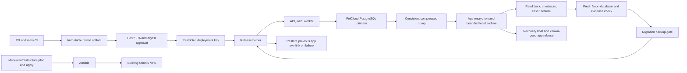

# NASJ infrastructure qualification

## Audit and disposition

- **Verified.** The merged production pipeline passed hosted CI and built its native release. The deployment job was skipped. Main has the required aggregate check. The production Environment restricts deploys to main.
- **Verified.** FelCloud is x86-64 Ubuntu with Node 24.20.0 and PostgreSQL 16. API, web, worker, and Certbot timer were active. Nginx syntax validation passed. The server reported 65 GiB free on the release filesystem. UFW was inactive and provider rules remain unverified.
- **Verified recovery evidence.** An initial Neon snapshot was restored back into an isolated PostgreSQL 16 cluster. Neon runs PostgreSQL 18. A matching PostgreSQL 18 export client was required. Live application database settings have remained on FelCloud.
- **Partial.** Runtime and migration role separation exists. Runtime lacks read access to Prisma migration history. The deployment scripts are merged, but the VPS still has its original real application directory and needs production qualification.
- **External.** A dedicated local backup volume, Age key custody, alert routing, and protected infrastructure credentials still need production configuration. No production apply, cutover, scheduled backup, or migration was performed during implementation.

## Architecture and decisions



Ansible installs configuration and canonical scripts. systemd schedules operations and supervises
the application. The production helper owns artifact authorization, switching and rollback.
Continuous delivery builds releases automatically. Production activation still requires host
authorization of the digest. A future automatic authorization design should verify a trusted
build attestation for the artifact, commit, repository, workflow and main ref using an independent
trust root. Transport credentials must never authorize their own uploads. Application rollback
retains the compatible expanded database schema.

Neon refresh creates a uniquely named database and validates migration checksums and every public
table's row count against the verified restore of the same dump. The pointer changes only after
verification. Existing copies and failed candidates are retained for operator review. Use a
dedicated Neon project and a role with CONNECT and CREATE DATABASE. Never configure the production
app to use the recovery endpoint. A portable PostgreSQL 16 archive is the preferred VPS recovery
source. Neon-native exports require a client at least as new as Neon.

## Configuration matrix

| Setting | Location | Purpose and state |
|---|---|---|
| `DEPLOY_HOST`, `DEPLOY_PORT`, `DEPLOY_USER`, `DEPLOY_SSH_KEY`, `DEPLOY_KNOWN_HOSTS` | GitHub production Environment | Exists by name. VPS restricted access still needs qualification. |
| `PRODUCTION_DEPLOY_ENABLED` | GitHub repository variable | Unset during qualification. |
| `INFRA_WORKFLOW_ENABLED` | GitHub repository variable | Unset pending infrastructure workflow qualification. |
| `INFRA_SSH_KEY`, `INFRA_KNOWN_HOSTS`, `INFRA_EXTRA_VARS` | Protected production-infrastructure Environment | Missing. Use a dedicated infrastructure user/key and trusted known_hosts. |
| `ansible_host`, `ansible_user`, `nasj_public_health_url` | Private Ansible extra vars | Supply actual endpoint, account and address. The tracked inventories contain placeholders. |
| `nasj_deploy_config` | Vault vars | Reviewed deploy config from the template. Existing file is preserved. |
| Runtime and migration env files | `/etc/nasj/runtime.env`, `/etc/nasj/migration.env` | Provision privately from the existing config, with separate owner groups. |
| `BACKUP_DATABASE`, `BACKUP_MAX_MIB`, `NEON_REFRESH_ENABLED` | Vault map entry `nasj_backup_files['backup.conf']` | Set the existing database name, archive limit (default 256 MiB), and enable nightly Neon refresh in production. A migration always requires Neon. |
| `nasj_backup_volume_uuid` | Private Ansible extra vars | UUID of a preformatted, capacity-bounded ext4 filesystem. Required for the opt-in mount playbook. No formatting is performed. |
| Age public recipients and restore identity | Vault map entries `backup.recipients`, `backup.identity` | Missing. Keep an independent recovery key copy outside the VPS. The production verifier requires a private identity to check its round trip. |
| `PGHOST`, `PGUSER`, `PGDATABASE=neondb` | Vault map entry `backup-neon.conf` | Existing recovery destination. Direct endpoint and verified TLS required. |
| Dedicated Neon password entry | Vault map entry `backup-neon.pgpass` | Supply securely. Use a database wildcard for newly named candidate databases, restricted to the exact Neon host and role. |
| HTTPS alert target and authentication | Vault map entry `notify.curl` | Missing. Supply a protected curl config with `url` and any auth headers. |

The selected storage is a private encrypted local filesystem at `/srv/nasj-backups`.
A loopback S3 service could reuse the old client abstraction but would add a server,
authentication and lifecycle configuration, a network listener, and resource overhead.
It would share the VPS failure domain either way. The filesystem creates no storage endpoint,
API or administrative interface, and removes the need for AWS credentials. Root owns archive
directories and files. The disposable restore account can write only its private workspace.
Do not configure the proposed port 9000 or buckets.

Use a dedicated, capacity-bounded filesystem with `nodev,nosuid,noexec,nofail`. Prefer a
separate block volume; an existing, fully preallocated image is an alternative only if its
capacity can be reserved without compromising the database filesystem. Never use an
unbounded sparse production file on the database disk. The backup refuses the PostgreSQL
filesystem and refuses to proceed if the mount is absent. The dump streams directly into Age encryption. Encrypted scratch files and temporary restore
clusters use the same bounded mount. The operation requires free space equal to at least six
times the configured per-file limit plus 512 MiB. Start by reserving 8 GiB for the current
small workload, measure growth and increase only after checking host capacity.

Retention treats daily, weekly, monthly and pre-migration archives independently with 30,
84, 183 and 30 days respectively. It considers only complete backup pairs and leaves the
newest verified pair per class. Review incomplete artifacts and obsolete Neon candidates
separately. The Neon refresh never drops a previous recovery database.

**Full VPS loss also loses the local archive history.** Neon is the only off-host database
recovery destination in this design. Its latest verified database is the recovery point.
If both FelCloud and Neon are inaccessible, this setup cannot recover the database. A same-host
receipt never qualifies a migration. The hook creates a new Neon database from the exact
current snapshot, compares restored table and migration evidence, and publishes a release-bound
off-host receipt only on success. Keep the current Neon project and recovery access recorded
outside the VPS. The production PostgreSQL data and Nginx/systemd service lifecycle are
independent of backup mount or Neon failure.

Configure an external heartbeat to detect loss of the host. The local monitor checks TLS,
applications, database, CPU load, memory, disk, local and off-host backup freshness, and
unfinished deployment state. Alerts need an operator-approved destination.

## Ordered operator qualification

From `infrastructure/ansible`, install `requirements.txt` into an isolated Python environment.
Prepare encrypted extra vars via `ansible-vault create /secure/nasj-production.yml`.
Supply the host address and trusted host SSH entry. Keep an independent administrator session and
provider console access before authorizing SSH changes.

```bash
ansible-playbook -i inventories/production/hosts.yml --ask-vault-pass \
  -e @/secure/nasj-production.yml playbooks/audit.yml
ansible-playbook -i inventories/production/hosts.yml --ask-vault-pass \
  -e @/secure/nasj-production.yml playbooks/configure.yml --check
```

1. Reserve and format a dedicated ext4 volume outside the PostgreSQL filesystem. Record its
   UUID. After separate mount approval, run `playbooks/mount-backup.yml` with
   `nasj_confirm_backup_mount=true` and the reviewed UUID. Verify `findmnt /srv/nasj-backups`.
   Review retention, Age key custody, Neon access and the notification route.
2. After explicit production apply authorization, rerun configure with
   `-e nasj_production_apply=true`. Qualify the restricted key and preserved SSH access
   separately before setting `nasj_reload_ssh=true`. Inventory-specific Nginx, TLS and systemd
   configuration remains in place. Do not paste generic replacement files over existing ones.
3. After approving the read grant, run `playbooks/database-grant.yml` with
   `nasj_confirm_database_grant=true` and the verified database/runtime/migration identifiers.
4. Run `playbooks/backup.yml` with `nasj_run_backup=true`. Require
   `NASJ_BACKUP_READY`, a matching local manifest and successful isolated restore. Require a fresh Neon
   receipt and test recovery from that database before enabling deployment. Run the backup twice and validate alarm delivery using a
   separate staging destination before enabling `nasj_enable_backup_timer` and
   `nasj_enable_monitoring`.
5. Review the artifact and approve a maintenance window. Run `playbooks/adopt-release.yml`
   with `nasj_confirm_adoption=true`, then `playbooks/verify.yml`. The adoption script requires
   a fresh verified backup, deployment lock, filesystem and capacity checks. An interrupted
   adoption retains the original and candidate paths in the pending marker.
6. Authorize the reviewed release digest as documented in [the deployment runbook](deployment.md).
   Enable CD only after host qualification, test one compatible release and separately exercise
   rollback. Verify public readiness and worker operations before declaring readiness.

For GitHub infrastructure automation, create the protected Environment and configure review
permissions independently of the application Environment. Run the workflow in plan mode on main,
review its result, then dispatch apply with the successful matching plan run ID. The workflow
runs fresh check mode before apply. Keep the flag unset until the protected Environment and
separate management credentials have been validated. A syntax-valid check run is not an
operational rehearsal.

## Replacement VPS recovery

Use a separate recovery inventory and `playbooks/bootstrap.yml` with
`nasj_confirm_bootstrap=true`. Recreate the approved runtime, migration, and monitoring roles,
and load the off-host copies of the real configuration, pinned Node runtime, trusted SSH host
records, credentials, PostgreSQL extension inventory, and DNS/TLS details. Preserve an off-host
encrypted copy of role grants/settings and archive a known-good application artifact beyond
GitHub Actions artifact expiry. The data backup excludes ownership and ACLs by design.

For complete VPS loss, use the latest verified Neon database. Export with a client matching
Neon and test on disposable PostgreSQL 16 before starting recovery. Create a PostgreSQL 16 custom-format dump from that validated restore for the recovery playbook. If the local archive
volume survived, check the Age archive SHA-256 and decrypt in a protected location. Then run `playbooks/disaster-recovery.yml` against an isolated
recovery inventory, with `nasj_confirm_restore=true`, `nasj_recovery_database=nasj_recovery_drill`, and the protected dump path. Confirm extensions, runtime grants,
application login/read/write smoke behavior and outbox handling before routing traffic. Start
the known-good app and worker only after verifying backup compatibility. Restore DNS, test public
TLS, and resume backups and alerting. Review potential duplicate background work before starting
the worker.

Initial RPO target is 24 hours, subject to successful nightly runs. Full VPS-loss RTO is
unmeasured. Record stage timings in the first replacement-host rehearsal. If lower RPO is
required, add periodic physical base backups and continuous encrypted WAL archiving with
restore-to-time drills. Neon restore history only covers the copy uploaded to Neon.

## Persistent qualification checklist

- [x] Read-only server audit and historical Neon recovery proof.
- [x] Deployment fault suite and disposable PostgreSQL evidence test.
- [x] Ansible syntax and inventory validation on local tooling.
- [x] P0 implementation: same-host archive, retention and independent migration gate.
- [x] P0: Qualify the bounded archive filesystem and mount idempotency in the Ubuntu VM.
- [x] P0: Exercise a real remote refresh against a separate synthetic Neon database or project.
- [x] P0: Validate full local archive pipeline and Ansible idempotency on disposable Ubuntu 24.04.
- [x] P0: Exercise synthetic adoption, restricted SSH deploy, rollback, alert, and recovery in the VM.
- [ ] P0: Qualify dedicated infrastructure and deploy SSH, backup credentials and alerts.
- [ ] P0: Authorize and qualify live backup, restricted access, adoption, first deploy and rollback.
- [ ] P1: Measure full recovery time and archive known-good releases and host config off-site.
- [ ] P2: Automate trusted provenance-based release authorization and evaluate WAL archiving.


## Validation record

| Check | Environment | Expected and observed result | Status |
|---|---|---|---|
| Existing deployment fault suite | Local temporary shell fixtures | Unauthorized artifacts, bad digests, lock contention, signal interruption, backup failures and restart/readiness/worker rollback were handled as expected. | Passed |
| Backup orchestration | Temporary filesystem and fake storage/restore adapters | Nightly and migration success, missing mount, failed write, invalid restore, failed Neon refresh and wrong Neon receipt passed. A same-host receipt alone cannot authorize migration. | Passed |
| Backup evidence | Local isolated PostgreSQL 16 Docker container | Matching restore returned identical evidence. Removing a row changed evidence. An unfinished migration failed the check. | Passed |
| Ansible inventory and syntax | Both checked-in sample inventories | Inventory parsing and playbook syntax completed. | Passed |
| ShellCheck, actionlint, YAML and Ansible lint | Local static checking | Scripts and workflows passed the checks run. | Passed |
| Systemd schedule | Local systemd calendar parser | The daily UTC trigger parsed. | Passed |
| VM boot and dedicated storage isolation | Ubuntu 24.04.5 minimal cloud guest on KVM | Verified image digest, successful cloud-init, pinned host key, separate ext4 archive device and restrictive mount options. | Passed |
| S3 upload and download | Not selected | Local filesystem opens no listener and requires no S3 account. | Not applicable |
| Dedicated volume provisioning and repeat apply | Disposable Ubuntu 24.04.5 guest | The storage role changed 2 tasks then 0 on the second run. UUID-based mount persistence changed 1 task then 0 on the second run. Neither run failed. | Passed |
| Full Ansible configuration idempotency | Disposable Ubuntu 24.04.5 guest | Second configure returned 28 OK, zero changed, and zero failed. | Passed |
| Local encrypted archive, retention and timer | Ubuntu guest, real Age, PostgreSQL 16 and systemd | The service wrote a valid encrypted backup receipt after a real isolated restore, retention kept its pinned pair and removed an expired pair, and the nightly timer scheduled successfully. | Passed |
| Restricted SSH and authorized release lifecycle | Ubuntu guest, synthetic release and real systemd/Nginx/TLS | Arbitrary command rejected, adoption succeeded and repeated cleanly, authorized candidate deployed, and worker failure restored the prior healthy release. | Passed |
| Recovery guard and invalid configurations | Ubuntu guest | A pending marker blocked the next release and was reconciled. Invalid Nginx, systemd and SSH files were rejected without affecting running services. Missing backup mount blocked backup while PostgreSQL still returned the fixture row. | Passed |
| Alert and database recovery | Ubuntu guest, test HTTPS receiver and synthetic database | Alert POST reached the receiver and returned 204. The archive restored into an isolated database and returned the expected fixture row. | Passed |
| Pre-migration off-host failure gate | Ubuntu guest and disposable mock tests | A real local archive with no Neon config failed the migration command and wrote no off-host receipt. Wrong remote receipts and failed refreshes also failed in the mock suite. | Passed |
| Fresh Neon recovery point from the new hook | No synthetic Neon destination connected to the VM | The earlier production Neon copy and independent restore remain valid historical evidence. The new candidate automation has not written to production Neon during this qualification. | Pending |
| Live rollback, artifact deployment, full disaster recovery timing | Production changes not authorized | Perform only after staging qualification and a verified remote recovery point. | Pending |

The application workflow still publishes and verifies the same artifact ID and checksum. Treat
a run that became superseded as a deliberate operator decision. Approve only the intended
reviewed digest, and revoke any unused release authorizations. Reuse the original artifact for
a retry. A rebuilt bundle requires fresh authorization even if its source commit matches.


## Local VM qualification

The development workstation has KVM, 12 logical CPUs, 15 GiB RAM and over 300 GiB
available on its workspace filesystem. Qualification booted a QEMU/KVM Ubuntu 24.04.5
guest with 2 vCPUs,
3 GiB RAM, a 24 GiB sparse OS image and a separate 8 GiB sparse test backup image.
The sparse devices are appropriate for the disposable workstation guest only.
SSH forwards on workstation loopback to guest port 22. The seed injects a unique
host key and the launcher writes a matching known_hosts file. The guest verified a
separate 7.8 GiB-formatted ext4 archive device with all three restricted mount flags.

Download the official Ubuntu 24.04 minimal amd64 cloud image and its SHA256SUMS
over HTTPS and verify the image before launching. Use a private work directory
outside the Git tree:

```bash
python3 -m venv /path/to/private-vm-tools
/path/to/private-vm-tools/bin/pip install -r infrastructure/staging/requirements.txt
/path/to/private-vm-tools/bin/python infrastructure/staging/prepare-vm.py \
  /path/to/verified-ubuntu.qcow2 /path/to/new-private-nasj-vm
```

Wait for `cloud-init status --wait` using the generated admin and pinned host key.
Run `bash infrastructure/staging/qualify-vm.sh /path/to/new-private-nasj-vm` from the
repository root. The harness provisions Ubuntu, configures twice, checks restricted SSH,
and exercises TLS health, Age archive recovery, retention, alerts, adoption, a synthetic
artifact switch and rollback, the recovery marker, and missing-mount handling. It uses a synthetic receipt only
after proving that a local archive does not pass the migration gate. A synthetic Neon branch/project and credential are required
for real remote integration. Never use the production recovery copy for fault injection.

## Production readiness audit, 2026-11-24

FelCloud still runs the original real release directory. API, web, worker, PostgreSQL,
Nginx and the Certbot timer were active. Nginx configuration validated and public
readiness returned `ready`. Only the 80 GiB VPS disk was visible. `/srv` and
`/var/lib/postgresql` share its root ext4 filesystem with 65 GiB free. No dedicated
backup block device is visible. Prefer requesting a separate volume. An explicitly
reserved, fully preallocated image is an alternative if the provider cannot attach
one and an operator reviews the capacity impact. Never mount an unbounded sparse
image on the production database filesystem.

The runtime and migration DB roles point to the same database and are distinct.
Neither has superuser, database-creation or role-creation rights. Only the migration
role can create in the public schema. The runtime role still needs SELECT on
`public._prisma_migrations`. PostgreSQL reported 19,364,887 bytes in the production
database. The new instrumentation measured a 2,501-byte encrypted synthetic archive in
3 seconds on the guest. The historical production Neon drill did not record archive size or
RTO. The live database size is not an archive measurement. No production dump
was taken for this audit. Existing runtime and migration secret files are 0640 and
0600 respectively and remain in place.

SSH listens on 22, permits public keys, disables password login, and permits public-key
root login and forwarding globally. The dedicated restrictions must be installed and
validated separately. UFW is inactive and the host reported no nftables tables. Provider
firewall controls and out-of-band recovery access still need confirmation. GitHub protects
main with the strict required workflow check and admin enforcement. The production
Environment restricts deployment to main and has the SSH credential entries. The
separate protected infrastructure Environment is absent. Both deployment flags are unset.

### Production storage activation

The separately authorized 20 GiB FelCloud data disk was formatted as ext4 and mounted
persistently by Ansible at `/srv/nasj-backups`. The mounted filesystem had 19 GiB
available with `nodev,nosuid,noexec`; PostgreSQL remained on the original root
filesystem with 65 GiB available. API, web, worker and PostgreSQL were active after
the mount. A subsequent read-only Ansible audit passed. This step did not configure
backup credentials, enable timers or activate deployment.

### Activation preflight follow-up

Base deployment helpers and the scoped sudo rule are installed. PostgreSQL 16.15,
the API, web, worker and Nginx were active. The backup mount remains isolated on
`/dev/vdb`; PostgreSQL is on `/dev/vda1`. The reviewed candidate `d63a7aa` matched
all 44 production migration names and checksums; the fresh audit also found zero
unfinished, non-rolled-back migrations. The migration table still has no explicit
runtime SELECT grant. The dedicated SSH user has no forced command or forwarding
restriction in the effective configuration. Console recovery access is unverified.

The release config and separate runtime and migration env files are absent. The
backup config, Age identity and recipients, direct Neon config and password file,
and alert config are absent. The existing production Neon recovery config is held
privately on the operator workstation. Synthetic Neon config is held separately.
The canonical off-host receipt is absent. Both automation flags remain unset.

### Neon remote qualification and retention

The private synthetic connection is available. Its direct hostname was derived
from the saved pooled URL and checked against the existing recovery hostname before
use. The real Ubuntu guest hook exposed inherited Neon channel binding at the local
peer-authenticated dump. The canonical backup script now clears the inherited
connection settings before the local dump. The retry passed encryption and local
PostgreSQL 16 restore (2,501 bytes, 4 seconds to local publication). A separate
verified-TLS connection probe from the guest timed out; workstation TCP port 5432
was reachable. The subsequent direct TLS guest test qualified the baseline receipt and reverse recovery. No production
database or existing recovery point was modified.

The old production recovery database remains a verified historical copy and was
excluded from testing. To reproduce the test, use a separate direct endpoint with
a role allowed to connect and create databases. On the Ubuntu guest, install the
updated scripts and provide root-only `backup-neon.conf` and
`backup-neon.pgpass` through private Vault vars. Run as guest root:

```bash
bash qualify-neon.sh SYNTHETIC_DIRECT_HOST PRODUCTION_DIRECT_HOST
```

Connectivity follow-up: both the workstation and Ubuntu guest resolved IPv4 and IPv6
addresses and had default routes. Bounded socket probes connected to TCP 5432 on
both address families, but the PostgreSQL SSLRequest (8-byte packet, code 80877103)
received no response within 3 seconds on either machine. Bounded
`openssl s_client -starttls postgres -verify_hostname HOST -verify_return_error`
probes also timed out. The current helper timed out during Neon refresh after
roughly 63 seconds. TLS certificate validation, authentication and SQL were never
reached. The guest NAT alone cannot explain the failure; the upstream cause is
unconfirmed. Do not relax TLS or channel binding.

Independent probes on 2026-11-24 around 20:02 UTC against the direct synthetic
endpoint in AWS `us-east-2`:

| Source | DNS / TCP 5432 | Traditional SSLRequest | Direct TLS with PostgreSQL ALPN | Certificate / hostname | Authentication / SQL |
| --- | --- | --- | --- | --- | --- |
| Workstation | Resolved / connected | Timed out in 6 seconds | TLS 1.3 | Verified | PostgreSQL 18.7 authenticated with channel binding required, executed SQL and confirmed CREATEDB |
| Ubuntu KVM guest | Resolved / connected | Timed out in 6 seconds | TLS 1.3 | Verified | Guest PostgreSQL 18.7 completed a verified remote restore and executed evidence queries |
| FelCloud | Resolved / connected | Negotiated TLS 1.3 | TLS 1.3 | Verified in both modes | Not attempted; credential-free network probe only |

The difference is specific to traditional negotiation over the development network.
Direct TLS and FelCloud's traditional negotiation both work at the transport layer.
The device dropping or withholding the traditional response is still unidentified.
Neon's public status page listed AWS us-east-2 database connectivity as operational
when checked. Account-level compute and access policy were not inspected. No
GitHub runner was configured or supplied with credentials. An independent hotspot
would help isolate the workstation network; current evidence does not justify a
permanent transport change.

GitHub confirmed artifact ID `14918288458`, name `production-release-1`, size
263,566,244 bytes, and the exact reviewed commit. The private workstation copy passed both digest checks and canonical safe
extraction. The extracted manifest confirmed the exact commit, Linux x64 and
Node v24.20.0. ZIP SHA-256: `1a206cbe2fd8a3ef884b60431132fcb04fbd14879185fc58eb8cb401cffc9b18`.
Bundle SHA-256: `1baa090ab7430db0665e0fc5a45c7c5c480ae4a79aa3b246ba871b51329ed5e5`.

The local connection-isolation regression
(`bash infrastructure/staging/check-backup-connection-isolation.sh` as guest root)
passed the real backup and isolated restore with invalid host, port, user, database,
password, service, SSL and PostgreSQL options inherited from the caller.
That local-only test does not generate a fresh off-host verification receipt.

The script requires the separate endpoint, runs the real pre-migration hook against a
synthetic database, checks evidence and the remote receipt, and verifies that a deliberately
invalid candidate has no receipt and cannot replace the local recovery pointer. It retains
both candidates. Export the verified candidate using a PostgreSQL client at least as new
as the remote server. Restore into a disposable PostgreSQL 16 database using the documented
compatibility procedure and compare the evidence and its synthetic fixture row. Record the
actual archive bytes and duration from `latest-offsite` and independently measure the
recovery time. The remote `nasj_recovery_metadata.receipt` table makes the successful
candidate and release association discoverable even if the VPS is lost.

Start with the newest seven verified daily candidates, four weekly candidates, three
monthly candidates, and a pinned known-good point and any release-bound candidates still
needed for an incident. Review database size and Neon plan usage weekly before changing
the policy. Account for full logical copies, Neon history retention, and failed candidates
separately. An operator must independently verify a newer restorable copy and obtain
approval before any deletion. No pruning of Neon databases is automated. Local retention
continues independently. Total VPS loss removes all same-host history.

### Guest remote qualification and transport

The disposable Ubuntu guest now has PostgreSQL 16 for local dump, verification and
restore, plus PostgreSQL 18.7 client tools for remote direct TLS. Installing the
second client exposed an unqualified `pg_restore` invocation: the newer wrapper
sent `SET transaction_timeout` to PostgreSQL 16. The local verifier now uses explicit
PostgreSQL 16 executables. The remote helper defaults to traditional negotiation
using PostgreSQL 16; the test-only `NEON_SSL_NEGOTIATION=direct` configuration
selects PostgreSQL 18. Both paths require hostname and CA verification and channel
binding. There is no automatic fallback.

The canonical guest hook created and verified a 2,501-byte encrypted archive and
published a release-bound Neon receipt in 21 seconds (3 seconds to local
publication). The full test, including a failed candidate with intentionally
mismatched evidence, took 49.7 seconds. The earlier verified receipt remained
unchanged and the failed remote candidate had no receipt. PostgreSQL 18 exported
the verified candidate and disposable PostgreSQL 16 restored and matched its
table and migration evidence in 22 seconds. A repeat with 25,000 additional
synthetic rows produced a 7,415,401-byte encrypted archive; local publication took
3 seconds and the off-host receipt took 103 seconds total (100 seconds after
local publication, including remote creation, transfer, restore and verification).
The full test including failure preservation took 174.1 seconds. CPU time for
the driving shell and children was 1.68 seconds user and 0.34 seconds system;
a sample during the reverse restore showed 343 MiB used in the 3 GiB guest.
The larger reverse restore matched evidence in 198 seconds. Peak memory and
separate upload/verification timings were not measured.
Only synthetic data was used. The read-only production Ansible audit passed
with no changes; the full check-mode plan awaits the production Vault inputs.
The original restricted SSH and activation gates remain unchanged.

For production approval, run the playbooks from `infrastructure/ansible` with the
production inventory and a private Vault file. The approval packages are:

- **A — Infrastructure:** Review `configure.yml --check --extra-vars @VAULT` with
  backup enabled and timer activation off. Apply with
  `-e nasj_production_apply=true` only after consent. Keep SSH configuration and
  reload off until independent console access is verified and the SSH change is
  authorized. Review `database-grant.yml -e nasj_confirm_database_grant=true`
  separately. Only the runtime migration-history SELECT grant is intended.
  Validate services, mount and permissions; preserve prior configuration for
  rollback. The existing 20 GiB disk must not be reformatted.
- **B — Backup qualification:** After approval run
  `backup.yml -e nasj_run_backup=true`, recover the fresh candidate independently,
  compare archive and remote evidence, and verify the canonical receipt is less
  than 24 hours old. Preserve all previous Neon candidates. A failed run or
  mismatched evidence stops activation; it must not be repaired by editing receipts.
- **C — Cutover:** After separate maintenance approval, run
  `adopt-release.yml -e nasj_confirm_adoption=true`; then authorize and deploy the
  digest-bound artifact per the deployment runbook. Verify API, web, worker and
  public HTTPS, and exercise rollback to the retained compatible prior release
  under the deployment lock. Reconcile the release state before enabling CD.
  Schedule and confirm backup and monitoring runs, with separately approved
  activation and flags. No production mutation was executed for this phase.

### Production activation approval steps

1. Review and merge the infrastructure PR after the required aggregate check passes. It includes the reusable infrastructure workflow as well as application and security checks.
2. Authorize the dedicated filesystem. Prepare the approved capacity-bounded ext4 device,
   collect its UUID, and run `mount-backup.yml -e nasj_confirm_backup_mount=true` with the
   UUID in private vars. Verify the mount options and distinct device with `findmnt`.
3. Approve Age key custody, the existing Neon recovery project and its dedicated access role,
   and a production HTTPS alert destination. Enter the encrypted Vault vars privately using
   the configuration matrix. Keep independent access to the recovery key and Neon account.
4. Run `audit.yml` then `configure.yml --check` using those vars. Review the resulting plan.
   After explicit authorization, run configure with `nasj_production_apply=true`. Keep the
   timer and SSH reload booleans off during this first apply.
5. Separately authorize `database-grant.yml -e nasj_confirm_database_grant=true` with the
   verified runtime and migration identifiers. Confirm runtime SELECT and no schema CREATE.
6. Run `backup.yml -e nasj_run_backup=true`, then independently recover the new Neon copy into
   PostgreSQL 16. With explicit backup-write authorization, invoke the installed
   `/etc/nasj/backup-before-migrate FULL_CANDIDATE_SHA` and require the matching local and
   remote receipts. This hook invocation creates a backup only. It does not run migrations.
7. Verify monitor and alert delivery. Approve turning on `nasj_enable_backup_timer` and
   `nasj_enable_monitoring` in a reviewed configure apply. Check `systemctl list-timers`
   and require a successful real scheduled run.
8. Preserve console access. Separately authorize the deploy SSH drop-in, reload and key test.
   Qualify denied arbitrary commands and confirm the independent admin session still works.
9. Authorize the maintenance window and `adopt-release.yml -e nasj_confirm_adoption=true`.
   Run `verify.yml` and retain the original application release.
10. Download the exact reviewed Actions artifact with `gh run download RUN_ID -n ARTIFACT_NAME`.
    Compare its SHA-256 with the reviewed build summary. Write the authorization file as in the
    deployment runbook. With separate deployment approval, send that exact archive through the
    forced SSH command, check API/web/worker and public health, and rehearse app rollback with
    approved compatible releases. Set the CD flag only after these checks pass.
11. Create the separate protected infrastructure Environment with main-only branch restrictions,
    protected approval and its own credentials. Qualify plan mode before any apply dispatch.
    Enable the infrastructure flag only after explicit authorization and that qualification.

No production mutation, off-host write, deployment activation or provider change was made
during this readiness audit.

### Package A preparation

See [Package A](production-package-a.md) for the A1–A4 commands, credentials,
verification and rollback. The workstation has an encrypted Vault starter with
host, UUID, role names, deploy and backup defaults. A dedicated production Age identity and recipient are now in Vault; independent
operator recovery custody remains to be confirmed. The existing production Neon
credential was staged separately from qualification. A read-only verified-TLS
probe confirmed CONNECT and CREATEDB without creating or changing a database.
The approved alert destination, console access and provider firewall review
remain operator inputs. Strict administrator SSH and public HTTPS readiness passed;
the application services and PostgreSQL remained active. No production apply,
database grant, SSH reload, notification or timer activation was performed.

Backup flow (nine scenarios), retention, real PostgreSQL evidence, deployment
faults, forced command rejection, schema gates, and tracked-history secret
scanning passed. The preserved artifact still matches the head of main at this
review; merge the infrastructure-only PR after required CI passes and retain the
reviewed artifact for the separately authorized first cutover.

The Vault-backed production plan with backups enabled completed with 21 OK,
10 predicted changes, 10 skipped, and zero failures. It previewed deploy.conf,
the archive mount-root permission change to 0711, private archive and restore
directories, Age installation with package service autostarts suppressed,
the unprivileged restore account, protected backup settings, canonical scripts,
and inactive systemd units. It did not include the SSH role or alert config.
The separate database-grant dry run passed its assertions and skipped SQL
execution; the live read-only query returned false for both migration-history
SELECT and public-schema CREATE for nasj_app. No grant was executed.

The operator selected Discord for A4. The notifier supports Discord content with
mentions disabled and retains generic HTTPS. Isolated HTTPS mock tests cover both
formats, certificate rejection and retry limits. Discord mode and production
environment are staged in the encrypted Vault; the private webhook URL,
independent Age custody and recovery-console/firewall confirmation are still
required before the combined dry run. No live alerts were sent.

After the operator confirmed independent Age recovery custody, console login
with sudo, and provider firewall review, the combined Package A structural dry
run completed with 25 OK, 13 proposed changed tasks, six skipped, and zero
failures. It included backup, restricted SSH files, and Discord configuration,
with SSH reload and timers explicitly disabled. The private local URL check
still rejected the saved webhook value; check mode does not validate delivery
or the credential. Package A4 remains blocked on a valid replacement URL.
PR #258 at 3546a4c passed the required hosted check and remains draft.
No production changes were applied.

After the replacement Discord webhook was saved, its URL and Discord mode passed
local validation without contacting Discord. The combined production check mode
was repeated with the corrected Vault: 25 OK, 13 proposed changes, six skipped,
zero failures. Operator confirmations for Age custody, recovery console with
sudo, and provider firewall review remain recorded. The alert delivery itself
is not yet qualified; it needs separate approval after configuration is applied.
Both production automation flags remained unset. Package A is at the approval
boundary; no production apply, grant, reload or alert was executed.

### Authorized A1/A4 installation

The approved `3546a4c` implementation was applied with only backup and notification
configuration enabled. Ansible returned 23 OK, 10 changed, eight skipped and
zero failures. The only installed package was Age; PostgreSQL was not upgraded.
The existing env files were copied without overwriting either destination.
Original env, fstab and sudo-policy checksums and the monitored service start
times remained unchanged. Public readiness returned ready. The backup mount
retains 19 GiB free on its independent ext4 filesystem; PostgreSQL retains
65 GiB free on root. Systemd unit verification succeeded with an IPv6 availability
warning, and the installed backup, monitoring and notifier units remained inactive.
Discord config passed local structural and permission checks; no request was sent.

The same-scope check-mode rerun returned 21 OK, zero changed, 10 skipped and zero
failures. The protected rollback snapshot and restore instructions are in the
[Package A runbook](production-package-a.md). A2, A3 and live notifier delivery
remain separate approvals. Neither automation flag was set and Packages B
and C were not started.

### Package A operational qualification

A2 added exactly non-grantable SELECT on the Prisma migration history table to
`nasj_app`, leaving public-schema CREATE false. The history checksum was
unchanged. A3 installed the two restricted SSH files and their root-owned key
directory; key matching, sudo and SSH syntax checks, and the on-disk effective
policy passed. SSH was not reloaded and its daemon state was unchanged. The
[Package A runbook](production-package-a.md) records the rollback snapshot,
exact reload command and post-reload verification. Live restricted SSH
qualification remains pending separate reload authorization.

The canonical notifier sent one labeled qualification test. Discord returned
HTTP 200 over verified TLS, with mentions disabled by the reviewed formatter.
Operator receipt confirmation is pending. Backup and monitoring timers remained
disabled. The systemd IPv6 warning was reproduced without a unit validation
failure: the current kernel has no IPv6 interface addresses or IPv6 web
listeners. IPv4 public HTTPS readiness and actual outbound Discord delivery
passed. This is not a blocker for the operations tested, but no IPv6 path is
qualified. All production services remained active, service start times
matched the prior snapshot, and the backup filesystem remained distinct from
PostgreSQL. Neither automation flag was set. Packages B and C were not started.

A3 live SSH qualification passed after the authorized reload. The operator
confirmed an open recovery console with sudo; a separate admin session was
held. Fresh strict-host-key administrator login and sudo passed. The dedicated
key authenticated, arbitrary command execution was denied by the forced
command, PTY and forwarding probes were denied, and the server offered
public-key authentication only. No read-only deployment verb exists, so no
artifact or deploy command was sent. No rollback was required. Production
services and IPv4 public HTTPS remained ready; timers and both automation
flags stayed disabled. The read-only kernel audit found historical soft
lockups/RCU stalls but none in the preceding 12 hours and no failed units.
The latest event was at 00:56:46 UTC on 2026-11-24, with a virtio GPU/framebuffer
stack. Root cause remains unconfirmed. The Package B authorization plan is
in the runbook; no production backup or Neon refresh was started.

### Package B production backup and independent recovery

The one-time authorized backup ran through `playbooks/backup.yml -e
nasj_run_backup=true`: three OK, one changed, zero failures. The preflight
database size was 19,389,463 bytes and the backup mount had about 19 GiB free.
There were no pre-existing local archives to prune. The canonical operation
produced a 3,606,110-byte Age archive. SHA-256 verification passed. Local
publication took 5 seconds including the canonical isolated restore. A
separately timed repeat restore of the encrypted archive into disposable
PostgreSQL 16 took 4 seconds. Off-host receipt publication took 160 seconds
total, roughly 155 seconds after local publication (create, transfer, restore
and verify combined; transfer-only timing was not collected).

A new candidate in the existing production Neon project matched both the remote
receipt and the canonical local snapshot evidence:
`NASJ_EVIDENCE:146:44:cb7d1f4de78d04e0c28e2fa6623372c0:8491d197a86b3513ae76a62a039d8b43`
(146 public tables, 44 applied migrations, migration digest and row-count
digest). An independent PostgreSQL 18 export and disposable PostgreSQL 16
restore on FelCloud matched that evidence in 30 seconds. The disposable
cluster and temporary client tooling were removed. Production data was not
sent to the workstation. The canonical adoption receipt was root-only, and
its archive digest, size, release marker and evidence matched the manifest and
remote receipt. It was published 2026-11-24 22:56:25 UTC (23:56 in Tunisia),
and is eligible through 2026-11-25 22:56:25 UTC (23:56 in Tunisia), subject to
the adoption gate. No previous recovery database was deleted or overwritten.

Across 72 monitoring samples, minimum available memory was 2,696 MiB; maximum
sampled CPU use was 50%, steal 1%, I/O wait 6%, and disk read/write rates were
208/4,620 KiB/s. There were no matching kernel warnings or failed health
samples. API, web, worker, PostgreSQL and Nginx were active before and after;
public HTTPS was ready and service start times were unchanged. The backup
oneshot finished successfully and returned inactive. Both timers and
automation flags remain off. The historical CPU stall risk remains under
observation. No migrations, adoption or deployment occurred.

### Package C authorization proposal

The proposed artifact is the already verified release `d63a7aa`,
artifact 14918288458, bundle SHA-256
`1baa090ab7430db0665e0fc5a45c7c5c480ae4a79aa3b246ba871b51329ed5e5`.
The bundle digest was rechecked and 44 migration checksums still match live.
Main advanced to `6f9454f` when PR #258 merged; its CI and release passed and
deployment was skipped. The delta is infrastructure/docs only, so the
preserved application artifact is still the concrete proposed target.
Choosing the newer artifact instead requires independent archive and bundle
verification and specific authorization.

In the approved maintenance window, recheck readiness, kernel health,
receipt freshness and exact artifact identity. With the existing Vault
command prefix, run `playbooks/adopt-release.yml -e
nasj_confirm_adoption=true`. It retains the current release for rollback
and restarts API, web and worker during adoption. Then write the exact
digest authorization in `/etc/nasj/releases/FULL_SHA` following the
deployment runbook and send the preserved bundle via the qualified
forced-command SSH identity:

```bash
ssh -o BatchMode=yes -o IdentitiesOnly=yes -o StrictHostKeyChecking=yes \
  -i PATH_TO_DEPLOY_KEY -l nasj-deploy nasj \
  'deploy d63a7aad49c3c8befded53cba334ab5c81477ab5 sha256:1baa090ab7430db0665e0fc5a45c7c5c480ae4a79aa3b246ba871b51329ed5e5' \
  < ~/.local/share/nasj-release.qVHh1s/release.tar.gz
```

Verify the release link, local API/web, worker status and public readiness.
Under the deployment lock, exercise the documented compatible application
rollback to the retained legacy release and verify it before reapplying the
same reviewed artifact if authorized. If health or a safety gate fails,
stop and preserve the last healthy release; consult the pending marker and
runbook before recovery. No migration approval, timer activation or CD flag
change is part of this proposal. If the receipt expires before adoption,
obtain separate approval for a fresh verified recovery run.

### Package C result: adopted, first artifact blocked

The final preflight verified administrator access (console had been operator
verified), healthy local and public services, a fresh root-only off-host receipt
and its archive, volume isolation, both exact artifact digests and manifest,
and all 44 live migration checksums. Current main `6f9454f` had only
infrastructure and documentation changes beyond the authorized `d63a7aa`.
The pre-cutover service config and deployment state are preserved on FelCloud
at `/root/nasj-package-c-preflight.tuTlbF`.

Canonical adoption passed. The original application is now active through
`/srv/nasj -> /srv/nasj-releases/legacy-20261124T230059Z`. The systemd journal
measured 3.03 seconds from the worker stop to worker start. Public probes
bracketed the adoption readiness interruption at roughly 2.5–5.0 seconds;
one isolated probe also missed before adoption while the application was
still untouched. Local API/database readiness, web, worker status and public
HTTPS passed after adoption and again after the failed deployment attempt.

The restricted identity reached the canonical helper with the authorization
for GitHub artifact 14918288458, commit `d63a7aa`. The helper stopped before
reading the bundle: `Unsafe trusted path parent: /var/log`. The live parent is
`root:syslog` mode 0775; the dedicated log directory is `root:root` mode 0700.
The deployment login also warned that its home directory did not exist;
authentication and forced-command execution worked. No candidate directory,
schema change, pending switch, current or previous artifact state was created.
No rollback switch or rehearsal was appropriate because the candidate never
became active. Under the deployment lock, the single-use authorization was
archived inside the protected preflight directory. The adopted legacy release
was left active and known good.

The sampled resource peaks were CPU 83%, steal 0%, I/O wait 0%, with minimum
available memory 2,753 MiB. There were no matching new kernel warnings, failed
host probes or error-priority app-unit journal entries. Application, PostgreSQL
and Nginx remain active. Neither timer nor automation flag was enabled.

To unblock the first artifact, review a repository change that puts deployment
logs under the existing verified root-owned state tree or another reviewed
root-owned tree. Preserve symlink/permission checks and avoid changing the
shared `/var/log` permissions. Test the Debian/Ubuntu group-writable parent
case in disposable qualification, then obtain separate production approval
to install the reviewed fix and retry the exact digest. Recheck the off-host
receipt at retry time; renew it only under separate backup authorization if
expired. Run the rollback rehearsal only after a successful artifact deployment.

After artifact and rollback qualification, obtain separate authorization to
enable the backup and monitor timers and verify a real scheduled archive, a
fresh Neon receipt and monitoring delivery. Production CD requires a protected
Environment, verified transport and explicit per-release digest approval;
activate only after a successful controlled deployment and recovery rehearsal.
For infrastructure automation, configure its separate protected Environment and
dedicated credentials, qualify plan mode, and separately authorize apply
activation. These capabilities were not activated during Package C.

### Deployment log correction and retry plan

FelCloud's shared `/var/log` is `root:syslog` 0775. The original helper
correctly rejected that group-writable ancestor even though
`/var/log/nasj-deploy` itself was 0700. The corrected helper logs only under
`/var/lib/nasj-deploy/logs`, does not depend on the shared directory, and checks
every log ancestor, directory ownership and mode, and symlinks. It uses unique
0600 logs, bounded captures and a fail-closed space/entry budget. Operational
evidence is retained; the helper does not prune logs.

The repository change updates the helper, the adoption worker log,
the Ansible deployment role, deploy configuration template, controlled
deployment tests and operational documentation. Existing `deploy.conf`
does not require a change because the log path is fixed. On separately
authorized production installation, verify the adopted legacy symlink,
service health and absence of a pending marker. Under the current deployment
lock, keep a root-only copy and checksum of `/usr/local/sbin/nasj-deploy`,
create `/var/lib/nasj-deploy/logs` using
`install -d -o root -g root -m 0700 /var/lib/nasj-deploy/logs`, and install the
reviewed helper beside the live file, validate syntax and digest, then rename
atomically over the live helper. Verify the installed digest, 0755 root:root
helper and 0700 root:root log directory, then recheck readiness and the
unchanged active symlink. No service restart or adoption is needed. Retain
the old log tree. To roll back, under the same lock stage the saved helper
as root:root 0755 beside the live file, check its original digest, and rename
it atomically into place. Preserve any new logs as evidence; no configuration
or service restart is required for this rollback.

For a separately authorized retry, reverify both preserved artifact digests,
manifest and live migration checksums. Recheck readiness, resources, kernel
warnings, strict SSH, adopted legacy symlink, and no pending state or
migration approval. Create a new mode-0600 authorization containing the
exact digest and use the existing forced-command upload. Do not reuse the
archived authorization or re-adopt. The normal helper checks an off-host
backup only in the migration branch; adoption has already passed its own
24-hour gate. For a migration-free retry, a fresh receipt is an operational
safety prerequisite, not a technical helper gate. Recheck it immediately
before retry. Obtain separate backup authorization if it has expired.
If the release unexpectedly needs a migration, stop. After successful
deployment, rehearse rollback to the retained legacy release and leave
it active. No timers or automation flags are part of this proposal.

#### Disposable log-path qualification

A fresh Ubuntu 24.04 KVM guest used a separate synthetic backup disk and
pinned SSH host key. Initial provisioning and configuration succeeded;
the second Ansible apply returned 28 OK, zero changed and zero failures.
The minimal image lacked a `syslog` group, so the guest-only regression
runner created that group before configuring the reproduction. The test
helper pointed deliberately at the old path and rejected the 0775
root:syslog ancestor. Without changing those permissions, the canonical
corrected helper accepted a verified synthetic artifact over restricted
SSH. Separate public HTTPS and worker faults each returned
`ROLLBACK_READY` and restored the verified active release. A pending marker
blocked a further attempt until reconciled. Both synthetic unprivileged
accounts were denied write access to the log directory; new logs were
root:root 0600 and the old tree remained untouched. The real VM lifecycle
and isolated database restore passed.

The local fault suite additionally passed authorization, archive checksum,
concurrency, signal interruption, unsafe state/log modes, log symlink and
budget exhaustion cases. Both Ansible inventories passed syntax checks,
and a full-history Gitleaks scan reported no findings. The correction is in
draft PR #259; no production mutation or deploy retry was executed.

### Package C retry: deployment and rollback qualified

The exact helper revision `621d387` passed hosted required CI (run
45507470486). The authorized helper correction installed SHA-256
`f4867504b4037465a3af8d125a67bb2b266aade662bd42d11a6bbda4c73b1ab1`
under the deployment lock. The prior helper and checksum are protected at
`/root/nasj-package-c-helper-rollback.XVuEhK`. The install created root:root
0700 `/var/lib/nasj-deploy/logs`; it changed neither the shared log tree nor
the application symlink or service start times. No restart was needed for
the helper install. Public HTTPS remained ready.

The retry reverified both artifact digests, GitHub artifact 14918288458,
commit `d63a7aad49c3c8befded53cba334ab5c81477ab5`, all 44 installed
migration names/checksums, the fresh receipt and matching encrypted archive,
and the absence of migration approval. The previous receipt was fresh, so
no new backup ran. A newly written exact-digest authorization was used.
Restricted SSH returned `DEPLOY_READY`; elapsed time including upload and
verification was 101.86 seconds. Public probes bracketed the readiness
interruption at 0.62–1.97 seconds. The candidate symlink, manifest, digest,
local API liveness and database readiness, web GET, worker status, public
API and web HTTP 200, and current/previous state all checked out. The three
root:root 0600 deployment logs were 13, 354, and 83 bytes. No unresolved
pending marker or migration approval was present.

The authorized application rollback switched to the retained
`/srv/nasj-releases/legacy-20261124T230059Z` under the deployment lock,
verified worker status and local/public readiness, and finished in 4.52
seconds end to end. Public probes bracketed its interruption at 1.84–3.09
seconds. The candidate is retained as `previous`, the active legacy target is
recorded by the adopted release and rehearsal marker, and artifact-only
`current` is absent. No pending marker remains. Retry authorization was
archived in the protected preflight snapshot; no automatic redeploy is
authorized. PostgreSQL connectivity passed and no database migration or
restore over production occurred.

There were 210 public and 49 host samples. Peak sampled CPU busy was 75%,
steal 1%, and I/O wait 8%; minimum available memory was 2,699 MiB. No failed
host samples, new matching kernel warnings, or error-priority application
journal entries were observed. SSH, API, web, worker, PostgreSQL and Nginx
are active and public HTTPS is ready. Backup and monitoring timers remain
inactive/disabled; both automation flags are unset.

### Package D proposal — separate approvals

1. Review and authorize repository integration of draft PR #259 after
   confirming current head and required CI. No production activation is
   implied by integration. The verified legacy release stays active unless a
   specific subsequent artifact deployment is authorized.
2. After separate production approval, enable and start the backup timer
   using the reviewed Ansible configuration, verify its scheduled firing,
   the encrypted archive and fresh verified Neon receipt, and inspect resource
   impact. Then separately activate monitoring, verify the actual timer,
   successful checks and protected Discord delivery. Disable the relevant
   timer if qualification fails; preserve all evidence and recovery points.
3. For CD, review the main-only production Environment and the pinned key,
   qualify the first GitHub-runner deployment with a reviewed SHA and
   exact-digest host authorization, and approve flag activation separately.
   If qualification fails, unset the flag and follow application rollback.
4. For infrastructure automation, provision the separate main-only protected
   Environment and dedicated access credentials. Separately authorize flag use
   for a plan-only dispatch, verify the audit/check output, and require an
   exact-main successful plan and explicit approval before any apply. Disable
   the flag if qualification fails.

None of Package D was executed.

### Package D progress

D1 repository integration: PR #259 was verified at
`621d387c91c2b18bfe9f89717ff6e4b935e863cd`, with the required check green,
no unresolved review threads, clean merge compatibility and the installed
FelCloud helper matching its qualified SHA-256. It was marked ready and
merged through the normal protected process as
`65ef68340f26f9c90af5f90cefdfe28a92f75751`. The resulting main workflow is
run 45511080088; D1 is not complete until that run passes. Both timers and
both automation flags remained off when the merge started.

For D2, the canonical timer runs daily at 02:00 UTC (03:00 Tunisia time)
with up to 15 minutes of jitter and supports missed calendar events via
`Persistent=true`. A manual oneshot cannot substitute for a scheduled run.
The scheduled run must be correlated with the unit journal, encrypted archive
and matching local/remote evidence before D3 can activate.

D4–D6 were reviewed for planning only. The existing production Environment
restricts deployments to main. The separate production-infrastructure
Environment does not yet exist. D4 must use the new merge commit's successful
main artifact if it qualifies, with independently checked API identity, ZIP and
bundle digests, strict SSH host-key pinning and an exact host-side authorization.
No deployment is authorized by this review.

For D5, use GitHub artifact attestations in the trusted release build job
after the bundle smoke test. Grant OIDC and attestation write permissions only
to the producer; the delivery job keeps the existing restricted SSH identity
and has no signing permissions. FelCloud independently verifies the bundle
digest and attestation, allowlists the repository, protected main ref and
signing workflow, and checks the required CI result for the matching commit
and attempt. Reject replay or stale releases and retain the exact-digest
manual recovery path. The signing trust and delivery trust must stay separate.
Keep the existing host lock, safe extraction, readiness checks, rollback and
audit logs. An attested bundle that needs migrations must still satisfy the
existing explicit migration approval and fresh verified backup gate.

For D6, prepare a main-only protected Environment with separately scoped
credentials and review of any elevation. Review all forced check-mode
overrides in the audit, configure and verify path (read-only probes and
validators), and test against a disposable guest with before/after state
evidence. Reject unexpected writes, unsafe task overrides and timer/reload
settings in a plan. Qualify via plan-only dispatch after separate flag
authorization; keep apply gated by the same-main successful plan and separate
approval. Do not repurpose the application deployment key.

D1 passed: the exact merge commit `65ef683` passed required CI in run
45511080088. D2 enabled the canonical production backup timer after the
mount, Age key pair and verified Neon connection checks. The first listed
trigger is 2026-11-25 02:05:54 UTC (03:05:54 Tunisia time); there was no prior
trigger at inspection. Scheduled archive/receipt verification remains pending.
The monitoring timer is still disabled. Candidate D4 artifact 14975897077
was identified in that main run; local digest and extraction checks are pending.

#### D4 verified candidate and proposed authorization

GitHub run 45511080088 (main push) passed required CI and release; deploy
was skipped. Artifact 14975897077 is tied to commit
`65ef68340f26f9c90af5f90cefdfe28a92f75751`. The downloaded ZIP matched
`c33ecc07b438480ffabae78699a83a337d28418f51c458ace5b24bb513ba403c`;
the internal bundle matched
`33e160c4049e8b6b988c7c0061387cd4832678c96fe83f1aea35feecf9073fa2`.
Canonical safe extraction validated the full commit. All 44 migrations in
the extracted artifact matched the live database. This artifact predates
cryptographic attestations; provenance was checked using GitHub run and
artifact metadata plus both byte digests. The exact bundle is held privately.

After D2 and D3 pass, obtain separate approval for one hosted-runner
deployment of those exact bytes. Recheck receipt freshness, live schema,
readiness, current main and the production Environment's pinned SSH settings.
The production Environment is main-only; secret entries exist but their
stored contents cannot be read back for comparison. Validate the pinned
host key and restricted credential in the approved runner operation.
Under the host lock, create root-only
`/etc/nasj/releases/65ef68340f26f9c90af5f90cefdfe28a92f75751` containing
`sha256:33e160c4049e8b6b988c7c0061387cd4832678c96fe83f1aea35feecf9073fa2`
with a trailing newline. Do not create a migration approval.

The current workflow has no one-time manual exact-artifact dispatch when
the global flag is unset. Prepare and review such a main-only dispatch
using the production Environment, original artifact/run IDs, both digest
checks and existing production concurrency group; authorize the dispatch
separately. Do not flip the global CD flag or rerun a build as a shortcut.
Record live readiness and preserve the retained legacy rollback path.

#### Isolated D5 and D6 work

The isolated D5 branch adds a pinned producer-only attestation step after
bundle smoke testing and a standalone host verifier. The verifier binds the
digest, trusted signing workflow, main commit, runner type and matching
run attempt; it rejects a bundle without an attestation. No live deploy
helper integration was added. A positive hosted signature test is still
needed; the verifier requires the producer run to be complete, so automatic
delivery must use a separate completed-run-triggered workflow rather
than waiting on its own CI run. Before activation, qualify lock-scoped
integration, replay behavior and negative signer/run/commit cases.

D6 audit, configure and verify check mode passed in the disposable Ubuntu
guest (2, 25 and 3 OK respectively, all with zero changes or failures).
The guest used a synthetic certificate timer and runtime shim. Protected
configuration hashes, selected modes, the live link and service start
timestamps were identical before and after. This qualifies the local
plan path, not the future protected GitHub Environment or runner access.
No production infrastructure apply was executed.

The production backup timer still has no trigger recorded; first listed
execution remains 03:05:54 Tunisia time on November 25. D2 and D3 stay
open and monitoring stays disabled.

The input-free D4 dispatch is proposed in PR #260 at `f43b1c1`. It
checks fixed metadata and both digests before using the protected main-only
production Environment and the existing concurrency group and pinned SSH
path. Local qualification used live GitHub metadata and the verified cached
ZIP: the exact input passed and a mismatched commit was rejected. Shell
syntax passed; the deployment step was not executed. Hosted CI and normal
protected merge are still pending. D2/D3 remain mandatory before dispatch.
Neither flag was set and no new host authorization was created.

#### D2/D3 scheduled qualification and D4 integration

D2 passed. The canonical backup timer fired 2026-11-25 02:06:07 UTC
(03:06:07 Tunisia). The successful oneshot journal ID matched the protected
manifest and off-host receipt. The encrypted archive was 3,606,110 bytes;
SHA-256 matched. Local restore and publication took 5 seconds and remote
receipt publication took 172 seconds total. The receipt was written at
02:08:59 UTC. Direct verified-TLS queries matched the remote receipt and
the 146-table, 44-migration evidence in the local snapshot. No manual backup
was used in place of the scheduled trigger.

D3 passed. The monitor timer triggered its oneshot at 09:58:51 UTC and
systemd recorded successful completion. The reviewed monitor checked app
units, worker status, PostgreSQL, local and public HTTPS readiness, certificate
expiry, filesystems, resource pressure, pending deployment and backup
freshness. A separately labeled Discord qualification alert returned
HTTP 200 with certificate verification result 0. The notifier secrets
were root-only 0600. Monitoring is scheduled every five minutes and does not
have durable alert deduplication; the notifier retry cap still applies.
FelCloud-hosted monitoring cannot independently report total VPS loss.

PR #260 exact head `f43b1c1` passed required CI in run 45513987710
and had no unresolved reviews. Normal protected merge produced
`8cfeecfea697566149bf4d8fb6070e2c773a451c`. The production Environment is
restricted to main. D4 awaits successful CI on that merge commit plus a
fresh preflight, exact host authorization and one dispatch. Neither global
automation flag was set. No deployment was dispatched in this step.

Post-merge required CI is tracked in run 45590579409. The authorized D4
artifact remains available with unchanged GitHub digest. No host release
authorization exists for D4 yet. D5 isolated test commit `9d48188` passed
ten simulated policy cases: exact, modified digest, missing attestation,
wrong repository, ref, signer and source, old main head, unsuccessful CI
and failed required job. Those cases test policy wiring and do not qualify
a real positive hosted signature or durable replay rejection.

D6 remains a separate protected plan package. The existing apply-capable
SSH credential model must not be reused for a plan-only key. The proposed
plan identity needs narrowly scoped read access through a root-owned fixed
probe or equivalent restricted command; regular SSH plus general sudo
would make check mode a convention rather than an access boundary.
The hosted environment and credentials have not been created or used.

D5 real hosted synthetic signature qualification passed in run 45590998432.
The runner verified the signed fixture, rejected the wrong ref and modified
bytes, and the workstation independently verified the original fixture and
the signed run-attempt identity. Commit `9ac3441` on the isolated D5 branch
adds a root-controlled host enable marker and atomically consumes one claim
per attested SHA under the deployment lock. The sandbox lifecycle suite
verified contention, replay after success, replay after interruption and
recovery via separately authorized manual exact-digest mode without clearing
the automated claim. This does not qualify a main production artifact or a
completed-run delivery workflow; neither helper nor enable marker was
installed on FelCloud.

D6's proposed protected Environment, forced read-only command, separate
credential names and manual approvals are in [D6 plan](nasj-d6-plan.md).
No hosted plan or apply was dispatched.

#### D4 result and retirement

Post-merge required CI passed for `8cfeecf` in run 45590579409. Preflight
verified the scheduled receipt was about eight hours old, its archive digest
matched, all 44 migrations matched the extracted candidate, and the legacy
release was healthy with no pending state or migration approval. One new
root-only exact-digest authorization was created.

The GitHub-hosted D4 dispatch 45592755245 succeeded. The artifact retrieval
and metadata/digest gate took about 14 seconds and the restricted SSH step
53 seconds. Artifact 14975897077 for
`65ef68340f26f9c90af5f90cefdfe28a92f75751` is now active. The full bundle digest
`33e160c4049e8b6b988c7c0061387cd4832678c96fe83f1aea35feecf9073fa2`
matched the installed manifest and current state. The retained legacy release
is previous, no pending marker remained, and no migration ran. Both local and
public API readiness, public liveness, worker status and PostgreSQL passed,
and public web returned HTTP 200. Samples bracketed public readiness
interruption between 1.37 and 3.73 seconds. Across 32 host samples, CPU
peaked at 57%, steal at 1%, I/O wait at 6%, and available memory did not
fall below 2,693 MiB. No new kernel warnings or error-priority app-unit
entries were recorded.

The one-time host approval was archived at
`/root/nasj-d4-qualification.i8H8XJ/release-authorization`; the dispatch
cannot deploy the same candidate without a new privileged grant. Removal
of the temporary workflow is awaiting protected review in PR #261.
Both backup and monitoring timers remain active. Both global automation
flags are unset. No infrastructure apply or other deployment was executed.

D5 activation requires the completed-run delivery workflow and a positive
end-to-end exercise of the protected-main producer policy in an isolated
environment. After review, separately approve installation of the verifier,
forced command and protected claim directory. Keep the host attested enable
marker absent until approved; enable the global flag only after qualification.
For rollback, unset the global flag, remove the host enable marker under the
lock and preserve the durable claims. Use separate manual digest authorization
for an approved rollback; do not clear claims to retry automatically.
D6 remains the [protected plan-only proposal](nasj-d6-plan.md).

#### D5/D6 activation preparation

D5 draft PR #262 (`a75581c`) contains the completed-run workflow, protected
host opt-in, verifier and durable claims. Local workflow gate tests accepted
the exact existing ZIP, rejected a wrong SHA, and did not deliver. Sandbox
tests passed duplicate no-op, lock contention, interrupted claim preservation,
separate manual recovery, failed public/worker rollback and missing migration
approval or verified backup. Hosted synthetic signing passed earlier in run
45590998432. The protected-main attested release delivery and guest reboot
test remain outstanding. Installation and activation details are in the
[D5 package](nasj-d5-activation.md).

D6 draft PR #263 (`646002d`) adds the input-free main-only workflow and fixed
read-only probe. In the disposable Ubuntu guest, restricted login returned
scoped JSON; arbitrary and extra-argument commands, TTY, forwarding and
general sudo were denied, and protected configuration hashes and service
start timestamps did not change. [D6 provisioning](nasj-d6-plan.md) details
the operator actions. No hosted plan or production provisioning was done.

D4 cleanup PR #261 still waits for the required browser check in run
45593081741. Its reviewed head remains `8464e10`. Production still serves
`65ef683`; the consumed one-time authorization is archived and absent from
the live release approvals. Both scheduled timers are active and both flags
remain unset. Do not merge the cleanup or claim removal from main until
required CI passes; then verify CI on the resulting main commit.

D5 architecture correction: draft PR #262 at `a290d93` replaces the rejected
`workflow_run` trigger with a same-run delivery job dependent on exact
successful required CI and release. Host validation now independently matches
the signed attempt's completed prerequisites and the attached ZIP/bundle,
without requiring the currently deploying run to be finished. Local
20-case verifier regression and canonical deployment faults passed. Hosted
PR checks, real protected-main delivery and guest reboot qualification
remain pending. See [D5 activation package](nasj-d5-activation.md).

#### D5 protected-main integration

The operator authorized repository integration only. Exact PR #262 head
`a290d93cf2552a2cb3561c0f65c450d219f9b5f9` passed required CI in run
45598094141 and had no unresolved review threads. It was marked ready
and merged normally to protected main as
`c33a8412d531f6114662ea8e78d717eb6e3ca113`. Post-merge run 45600440813
was still in progress at the latest check. Both production variables
remained unset; PR #263 was not merged.

The disposable Ubuntu guest received only the merged helper files and
verification tooling. Their hashes matched the reviewed implementation.
With the guest opt-in absent, restricted SSH rejected attested delivery,
kept the synthetic legacy release active and did not consume a claim.
Baseline CPU, memory, filesystem and network counters were captured for
the positive exercise. The temporary scoped GitHub token file did not
exist at the local path supplied to the assistant at the time of checking;
no GitHub account credential was copied or substituted. Positive real
artifact delivery, reboot replay and resource measurements are pending
successful main CI, the resulting artifact and the scoped credential.
No D5 code or credential was installed on FelCloud.

D5 post-merge main run 45600440813 passed required CI and release; production
deployment was skipped. Artifact 15016176590 for `c33a841` passed GitHub ZIP
and internal bundle SHA-256 checks and workstation cryptographic attestation
verification against the main source and trusted workflow. The scoped token
became available at mode 0600 and passed the protected-main lookup from the
disposable guest. Restricted SSH delivered the bundle to the isolated host;
the host independently began downloading the GitHub ZIP to verify its artifact
association. At roughly 58 seconds it had downloaded 10,747,904 bytes of the
263,565,980-byte ZIP. At that rate it may exceed the verifier's 300-second
timeout. No release switch or reboot result is recorded at this checkpoint.
Neither global flag was set and nothing was installed on FelCloud.

#### D5 real guest attempt: verification download timed out

The exact protected-main signed bundle (263,565,653 bytes) reached the
disposable guest over pinned restricted SSH. The independent ZIP read
(263,565,980 bytes) hit its 300-second timeout. The full command returned
124 and `DEPLOY_FAILED` after 314.3 seconds. At 132 seconds the ZIP was
26,230,784 bytes; at 275 seconds it was 47,874,048 bytes (~170 KiB/s
cumulative). The verifier failed closed: the synthetic prior release
remained active and ready; no pending marker or attested claim was written;
the partial ZIP and incoming upload were removed; the deploy lock was free.
There was no release to reboot-test. The scoped credential remains protected.

The workstation's 4 MiB range probe on the same artifact took 36.02 seconds
(113.7 KiB/s) after a 0.73-second API redirect. A guest 4 MiB range probe
hit its 50-second cap; a 1 MiB guest probe completed in 15.15 seconds
(67.6 KiB/s) after a 0.81-second API redirect. This is not isolated to the guest; available evidence
does not distinguish GitHub storage/edge throughput from the shared
development network. The loopback SSH upload and metadata API are not the
observed bottleneck. At 114–170 KiB/s a 251 MiB ZIP would take roughly
25–38 minutes; the 1 GiB supported cap would take roughly 103–153 minutes.
The existing deadline needs at least 0.84 MiB/s for this ZIP and 3.42 MiB/s
at the cap, before overhead. Simply extending it would hold the deployment
lock for an impractical time.

Proposed correction for review: have the trusted producer attest after
immutable upload, with a signed predicate binding the bundle SHA-256 to
the repository, run and attempt, artifact ID and ZIP digest. The host would
independently verify that signed binding and GitHub's matching artifact
metadata, plus the received bundle hash, trusted signing identity, current
main and successful required/release jobs. The delivery workflow would
continue validating the ZIP and internal digests. The bare bundle attestation
already proves signed bundle provenance but not membership in a specific
GitHub artifact ZIP; removing the independent ZIP read without an equivalent
signed binding changes that guarantee. Do not change the policy or deadline
until reviewed. D5 production activation and guest reboot qualification
remain blocked. No FelCloud mutation or global flag change occurred.

#### D5 signed binding correction

The approved correction was implemented at `7ad3da8` on
`fix/nasj-d5-signed-binding`. The release job preserves SLSA provenance
and signs a versioned custom predicate after upload, using exact artifact
API metadata. Delivery checks the ZIP and extracted bundle digests;
the host compares both verified signing certificates' run invocation URI,
the signed binding and independently queried artifact/run/job metadata.
The host no longer downloads the ZIP. The final main check, replay claims,
filesystem protections and migration/backup gates are unchanged.
The pinned action declares custom predicate support, and the installed gh
supports predicate selection; its live verification JSON confirmed the
certificate URI matches the SLSA invocation ID. The real custom predicate
producer and guest delivery/reboot still require a new protected-main
build after separately approved integration.

Local verifier policy and deployment fault suites passed, including invalid,
untrusted, missing, conflicting, malformed and oversized binding cases,
artifact metadata mismatches and unavailable API. The verifier SHA-256 is
`cb7b36580098a43b82092f941ed525faa61d33ea615bfa40521cecc239207cde`.
No FelCloud changes, global flag changes, or infrastructure apply occurred.

The operator authorized merging PR #264 only after required hosted CI passes.
The exact reviewed head `7ad3da879ecae4ad897e8ed416331ce14182b1b9` matched,
with no unresolved review threads and both flags unset. Run 45690826075 was
still in progress without reported failures at this check; no merge occurred.
The disposable guest was reachable and healthy on its synthetic release; its
deploy lock was free, no pending deployment existed, and the scoped token
was still protected (root-owned 0600). Positive qualification requires the new
protected-main artifact after integration; the previous artifact is not a
substitute.

PR #264 exact head `7ad3da8` passed the full required check in run
45690826075 and merged through branch protection as
`bbdccf07c81394c984abbfe177a18217d1a1435b`. Main run 45692827228 now gates
qualification. The guest delivery/reboot harness was updated to require
the new commit, explicit archive digest and both predicate types. No old
artifact was reused, no production changes were made, and both flags
remained unset.

Main run 45692827228 passed required CI and release publication for
`bbdccf07c81394c984abbfe177a18217d1a1435b`. The new artifact is
15059814960 (263,566,190 bytes; GitHub ZIP SHA-256
`56a0fd7906dc8fa079d5aab54e2846699aa15d461636c5ea8c7542112c5492a9`).
Its private download and verification are underway. On the disposable guest
only, the corrected verifier was installed under the deployment lock and
matched reviewed SHA-256. The guest's scoped read-only credential verified
the exact current main head and all fixture services remained active.
Dual-signature and reboot replay evidence are pending the full download.

#### D5 final signed-binding guest qualification

Passed with protected-main commit `bbdccf07c81394c984abbfe177a18217d1a1435b`,
run 45692827228 attempt 1, immutable artifact 15059814960. ZIP SHA-256
`56a0fd7906dc8fa079d5aab54e2846699aa15d461636c5ea8c7542112c5492a9` (263,566,190
bytes) and internal SHA-256
`ffb892bffdcd53d59638c8b5f34f3f043b3444b5c1151fb3d74c75cbfa15ba32` both
passed independently. Both real cryptographic attestations passed on the
workstation and the unchanged reviewed host verifier, which also matched
their certificate invocation URI, predicate, exact GitHub metadata, main
eligibility and completed prerequisite jobs. The real originating run was
completed; in-progress eligibility remains covered by the local state tests.

Restricted SSH deployed the exact signed bundle with no manual digest
approval. Guest synthetic API/web/worker services, real PostgreSQL and local
HTTPS were healthy. The artifact manifest, active symlink, current/previous
state and protected replay claim matched. A real guest reboot changed its
boot ID; replay of the same exact bytes returned `DEPLOY_ALREADY_CURRENT`.
The previous release and claim were retained, and the boot journal showed
only the initial starts, no restarts during the duplicate. No pending marker
or upload temp file remained and the lock was free.

The initial SSH delivery, verification and deployment took 39.2 seconds,
versus 314.3 seconds for the previous timeout. The guest’s original signature
check took 11.514 s, binding check 7.545 s, and five metadata/ref calls
3.644 s combined (22.703 s combined measured GitHub calls). The 41 host
samples showed about 274.0 MB received and 0.52 MB sent, 53% peak sampled CPU
and at least 2,526,276 KiB memory available. Peak sampled filesystem increase
was 1,320,747,008 bytes, including the staged release and incoming bundle;
no second full ZIP was downloaded. The sampled lock span was 37.21 seconds.
Duplicate delivery after reboot took 22.13 s. Stage durations not separately
instrumented are not inferred from the difference. The guest timing shim
delegated to the real CLI and was removed from the command path after testing.

The setup used a disposable runtime fixture and real systemd, restricted SSH,
Nginx and PostgreSQL; the hosted producer separately smoke-tested the native
application bundle. The production delivery job stayed skipped. This
qualification did not exercise a live production hosted automatic delivery.
Both automation flags remain unset. FelCloud was untouched.

#### D5 production installation preflight

The operator authorized installation only. The three helper hashes at
`bbdccf07c81394c984abbfe177a18217d1a1435b` match the qualified revision.
The disposable deployment used fixture application services with real
systemd, SSH, Nginx and PostgreSQL; the actual bundle was independently
smoke-tested by the hosted producer. The real signature test used a
completed main run. Accept/reject behavior for in-progress runs was
qualified by local policy tests only.

Strict administrator SSH and non-interactive sudo worked and the recorded
SSH rollback snapshot was readable. The active release was `65ef683`,
API/web/worker, PostgreSQL and Nginx were active, and public HTTPS returned
ready. Both scheduled timers were active, the off-host receipt was about
19 hours old, and root/backup free space was 63/19 GiB. The host gate was
absent, the deployment lock was free with no pending marker, and both
global flags were unset. jq is present; a reviewed GitHub CLI executable
still needs to be provisioned on the verifier's fixed PATH.

Installation stopped before any production writes because
`~/.config/nasj/production-verifier.token` was not visible on the workstation.
No qualification or broader GitHub credential was substituted. Recheck
all live preconditions at installation time; no installation or activation
has occurred.

#### D5 production installation (activation held)

Installed the exact three qualified helpers from `bbdccf0` under the
deployment lock, the guest-qualified GitHub CLI on the verifier's fixed
PATH, and the separate root-only 0600 production token. The scoped token
passed read-only Contents, Actions, and Attestations queries before the
atomic helper replacements. The root-only replay directory was created
and remains empty. All helper checksums, CLI bytes, desired file modes
and token byte comparison passed a non-mutating convergence check;
no second apply was needed. Existing deploy config, SSH drop-in, sudo
rule, and application/service start times are unchanged. The rollback
snapshot is `/root/nasj-d5-install-rollback.LpPF48`.

Strict administrator access passed. The restricted key still denied
`id`; a deliberately empty attested request was rejected with the host
gate absent, without switching the release or leaving an upload file,
pending marker or replay claim. FelCloud remains on `65ef683`. Local API,
web and worker checks, Nginx and PostgreSQL services and public HTTPS were
healthy. Both timers remained active; the scheduled off-host receipt
was roughly 18 h 45 min old at install. Both GitHub automation flags
are unset. No migrations, application deployment, SSH reload or D6
merge occurred.

#### D5 controlled production activation preflight

The operator approved production CD activation. The active release was
`65ef68340f26f9c90af5f90cefdfe28a92f75751`. Strict administrator SSH,
noninteractive sudo, the SSH recovery snapshot, the D5 helper rollback
snapshot, and an available deployment lock with no pending state were
verified. The three installed helpers matched the qualified hashes.
API, web, worker, PostgreSQL, Nginx, and public HTTPS readiness passed.
Root and dedicated backup volume free space were 63 GiB and 19 GiB.
Both production timers were active, and their last service results
were successful.

The scheduled off-host receipt dated 2026-11-25 02:08:59 UTC matched the
encrypted archive size and SHA-256 and was less than 24 hours old; the
next backup remained scheduled. All 44 applied Prisma migration names
and checksums matched the candidate, and the schema probe returned
`SCHEMA_READY`. The complete diff from the live release was confined to
deployment/CI infrastructure and documentation. PR #265 itself changed
only the deployment runbook. Branch protection required the aggregate
`required` check against current main and enforced it for administrators.

After PR CI run 45700448536 passed, the root-only host marker was created
under the deployment lock and `PRODUCTION_DEPLOY_ENABLED` set to true.
PR #265 merged through branch protection as
`d4fa5749d94ac5d9099f613a1201e543e5a4a193`. The merge tree matched the
reviewed PR tree. `INFRA_WORKFLOW_ENABLED` remained unset.

#### D5 controlled production activation result

Protected-main run 45702554469, attempt 1, passed the aggregate required
job and bundle smoke test. The release job published both attestations.
Artifact 15064731828 was 263,564,640 bytes. The delivery runner verified
the ZIP and bundle SHA-256 in approximately six seconds. The ZIP digest was
`d75067320b7b05ffc3134a4131720f2bd8ba3874300d64ae39dc24e88acab8c1`;
the bundle digest was
`e6f1697745bce2f4348b374ed45c633e33d25452312f3cf7f631a2eea3f3c99d`.

The hosted run failed in pinned SSH delivery at 21:29:49 UTC. Both SSH
environment inputs were empty in the called workflow. OpenSSH rejected
the unpinned ED25519 host key before authentication, and FelCloud's SSH
journal recorded the pre-authentication close. The stored environment
secret names are present. The recorded host key fingerprint matched
the key obtained by an independent, strict administrator connection.
Use a direct delivery job with the main-only production Environment,
as in the successful D4 job, and validate that both SSH inputs are
nonempty before making a connection. Preserve job permission separation,
host pinning, concurrency and restricted SSH. Qualify the corrected
workflow with disposable credentials before another production attempt.

Host authorization and live dual-attestation verification were never
reached, so there are no production host verification or deployment
durations for this run. The symlink never switched. The service start
timestamps were unchanged and all 1,345 sampled HTTPS readiness checks
passed. No pending state or replay claim was created. The prior rollback
target was still present. Production remained on `65ef683`.

The production deployment variable was deleted and the host marker
archived under the deployment lock at `/root/nasj-d5-disarm.O4GjkS`.
Both global variables are unset, both timers remain active, PostgreSQL
accepts connections and public HTTPS reports ready. The private
workstation evidence is in `~/.config/nasj/d5-production-45702554469`.
D5 remains unqualified in production. D6 and infrastructure apply were
outside this operation.

#### D5 direct SSH delivery correction

Draft PR #266 moves delivery directly into the protected-main CI workflow.
In D4 run 45592755245 the direct job received `DEPLOY_SSH_KEY` and
`DEPLOY_KNOWN_HOSTS` from the main-only production Environment and
completed pinned delivery. In D5 run 45702554469 the called job had
`environment: production` and received the configured host, port and
`nasj-deploy` username, but both SSH inputs expanded to empty strings.
The caller passed artifact inputs only. Both Environment secret names are
still present and the Environment still allows only main. The pinned
administrator connection confirmed the same server fingerprint as the
existing workstation pin. No production secret values were imported or
printed.

The correction keeps signing in the release job. Delivery retains
`needs: [required, release]`, the protected-main push and CD gates,
the production Environment, `actions: read`, a 30-minute time limit,
and the non-cancelling production concurrency group. The step validates
both Environment inputs, the login parameters, private key format, and
the existence of a matching host/port pin before downloading bytes.
It checks both the ZIP and bundle, uses a dedicated known-hosts file with
strict pinned SSH, and removes the temporary credentials on failure or
after delivery. The reusable deployment workflow had no other consumers
and was removed.

The local shell-step regression covered missing and invalid credentials,
unmatched host or port, invalid connection parameters, both checksum
mismatches, cleanup, and the deployment job contract. The native
deployment and provenance suites passed, including failed and incomplete
prerequisite rejection, the in-progress workflow policy, and host lock
contention. Run 45706093418 exercised the final delivery steps with
branch-scoped disposable Environment credentials and loopback OpenSSH
on hosted Ubuntu runners. It fetched artifact 15064731828 by immutable
ID, verified both digests, rejected a wrong key for the same address,
rejected an arbitrary command through the canonical forced wrapper,
accepted the exact bundle bytes and immutable command at the receiving
fixture, and proved cleanup. The two GitHub jobs ran serially
(21:37:54–21:38:35 and 21:38:41–21:39:58 UTC). No production endpoint
or credential was used for this test.

This test used an SSH receiver fixture, not a production application
deployment. Live in-progress source-run authorization cannot be
demonstrated with this fixture artifact because the actual source run
ended in failure. The prior real guest deployment used a completed,
successful protected-main run. The first controlled production attempt
after integration must still demonstrate real in-progress authorization
and application readiness.

The correction review head is
`1f1e2ef808b239594cc94c1c6981bdb478f68c3c`. Hosted evidence run
45706499331 independently verified both cryptographic signatures for
the exact protected-main artifact and confirmed its source attempt
concluded in failure. The three disposable GitHub Environment secrets
were revoked after both hosted tests. Strict administrator SSH confirmed
the production host marker absent, release `65ef683` active, both timers
running and public readiness passing. D6 remains independent.

Final PR head CI run 45706063688 and standalone checks run 45706049202
completed successfully. The protected `required` check passed. The
reviewed CI workflow SHA-256 is
`e84c766f3140f85644d4f69878968a05418f1422a6b06968b1a048ecfa53e54f`.
PR #266 remains draft pending integration approval. The retry sequence
and kill switches are recorded in the D5 activation runbook. No
production workflow was rerun.

#### D5 direct delivery integration and controlled retry preflight

PR #266 at `1f1e2ef808b239594cc94c1c6981bdb478f68c3c` passed the
protected required check. GitHub reported no additional review
requirements. With both automation variables unset and the live root
marker absent, PR #266 was marked ready and merged at the exact head
through branch protection as `7d0d5422b817cd583995aac35eb8aecc7f4c7f09`.

Draft PR #267 at `b12ad36bd8f961a415bee3d1d445240d8e737a2d` changes
only three deployment runbook lines. The full diff from live `65ef683`
affects CI/deployment code and documentation. No application or Prisma
migration files changed and all 44 applied names and SHA-256 checksums
matched production. The host, port and user in the main-only production
Environment match the trusted FelCloud endpoint and restricted account.
The SSH journal for successful D4 delivery matches the current restricted
key fingerprint. The independently pinned FelCloud host key matches the
live machine. Both GitHub Environment secret names and last-updated
timestamps match the D4 configuration. GitHub does not disclose stored
secret bytes. The exact production Environment injection will be checked
by the direct job during the separately approved retry.

Strict administrator SSH and sudo succeeded, both recovery snapshots and
the previous release were present, the deployment lock was free, and
there was no pending deployment. Installed helper hashes matched their
previously reviewed binaries. API, web, worker, PostgreSQL and Nginx
were active and public HTTPS returned ready. Both timers were active.
The approximately 20-hour-old off-host receipt matched the encrypted
archive checksum. Free space was 63 GiB on root and 19 GiB on the
dedicated backup mount. Recheck freshness and live state immediately
before any authorized activation.

Protected-main run 45710617654, attempt 1, passed required CI and
the packaged PostgreSQL 16 smoke test. Both signing steps succeeded
and the GitHub Attestations API returned both the SLSA provenance and
custom artifact-binding predicates for the exact bundle digest
`b31252c9b53ae253171b40353a171cd2708a0d6295be02a2d4e05ac7889193ac`.
The signed binding fields matched main, commit, workflow, run, attempt,
artifact 15068157075, 263,564,547 bytes, and ZIP digest
`1d444590a50852f1c4245db38e418093ba428bf0daaa84764e30ce508d58350e`.
The direct production delivery job was skipped. This integration artifact
is evidence only. The separately approved retry must use its own newly
qualified main artifact.

Draft PR #267 passed its protected required check in run 45710663210 and
is mergeable at the reviewed head. Final production checks confirmed
both automation flags unset, the host marker absent, the deploy lock
free, all relevant services and timers active and HTTPS ready. The
receipt was about 20 hours 12 minutes old and still matched the encrypted
archive size and digest. Recovery freshness must be verified again at
activation. D6 remains open and unmerged. The retry is prepared and
held for explicit activation approval.

#### D5 controlled production retry

The operator separately approved draft PR #267 at
`b12ad36bd8f961a415bee3d1d445240d8e737a2d`. Fresh preflight found the
previous release healthy, both feature variables unset, the host marker
absent, the deployment lock free, and no competing main workflow. Strict
administrator access, recorded recovery access, rollback storage, the
three helper checksums and all 44 applied Prisma checksums passed. The
entire candidate diff against live `65ef683` had no application or
migration changes.

The canonical production backup service completed successfully in 164
seconds before either deployment gate was enabled. New encrypted
archive SHA-256:
`4d640eaf14b1ea1f8d45208e6e57f30e5c851ed39c103a5581c8d9c37a68218c`
(3,606,110 bytes). Restore evidence covered 146 tables and 44 migration
checksums. The archive bytes and local recovery manifest matched the
receipt published at 22:25:57 UTC on 2026-11-25. A separate
certificate-validated TLS query to the newly verified Neon database
returned the matching restore evidence, snapshot ID and archive digest.
Application readiness remained healthy during the backup.

The root-only host gate was created under the deployment lock and
`PRODUCTION_DEPLOY_ENABLED` was set. PR #267 was marked ready and merged
through branch protection as `a8b5a216e8cd850a72a0995ed3659825229806b5`.
The reviewed PR tree and merge tree were identical. The release came
from main run 45713257601. `INFRA_WORKFLOW_ENABLED` remained unset.

#### D5 production acceptance

Protected-main workflow 45713257601, attempt 1, completed successfully.
Required CI and release passed. The direct delivery job validated both
production Environment SSH inputs before downloading the artifact,
verified the ZIP and bundle hashes, delivered over pinned restricted
SSH, and cleaned up its credentials. Artifact 15068064854
(263,564,627 bytes) had ZIP SHA-256
`21088fad84686217d6bbf6924fbf08fd87516d3416e551aef5001ab7690c515d`
and bundle SHA-256
`43423729ee3e87736137ad95feba31e2d07fa6bf783fe92f0c338b9a5cd5562d`.
GitHub returned both signed predicates and the signed binding matched the
immutable artifact metadata. FelCloud independently verified both
attestations and successful prerequisite CI at 22:40:21 UTC, before the
same workflow's delivery job completed at 22:40:45 UTC. The reviewed
verifier used the delivered bundle and bounded metadata reads with no
second ZIP download.

Runner ZIP and bundle retrieval/verification took about 13 seconds.
The final runner bundle checksum to the FelCloud provenance success
message took 45.0 seconds including SSH transfer and verification.
The exact verifier-only duration was not captured. The checksum to
`DEPLOY_READY` interval was 69.0 seconds. The host journal recorded
API/web restart and worker stop at 22:40:41 UTC, worker start at
22:40:44, and the runner reported full readiness at 22:40:45.
Two retained Nginx readiness responses during the switch were HTTP 200.
The workstation sampling file was unavailable after interruption, so
continuous public interruption duration could not be measured.

The canonical helper atomically activated
`a8b5a216e8cd850a72a0995ed3659825229806b5`. Live symlink, recorded
current digest, and durable replay claim agreed. The schema check
reported `SCHEMA_READY`, and no migration was executed. The deployment
lock was free, no pending state remained, and verified prior release
`65ef68340f26f9c90af5f90cefdfe28a92f75751` remains on disk for rollback.
Local API and web, worker, PostgreSQL and public HTTPS passed postflight.
Nginx and both scheduled timers remained active, and the most recent
scheduled backup and monitoring service results were successful.

D5 is accepted with `PRODUCTION_DEPLOY_ENABLED=true` and the root-owned
0600 host gate present. `INFRA_WORKFLOW_ENABLED` remains unset and D6
remains unmerged. The disposable verification token may be revoked
independently of the separate production verifier credential. Workflow
and attestation metadata are archived under
`~/.config/nasj/d5-production-45713257601`.

#### D5 closure, 26 November 2026

Archived the successful production host deployment log alongside the
GitHub run, artifact and attestation evidence. Preserved disposable
serial logs, D6 plan evidence and exact guest qualification ZIPs in
private workstation evidence storage. Removed the disposable hosted
Environment after confirming it held zero secrets, removed its branch
after retaining the exact source revision in a local evidence tag, and
retired the powered-off shared qualification guest and its disposable
keys. A future D6 hosted test must recreate the guest. The standalone
disposable GitHub token file was already absent. Account-side revocation
could not be verified from the workstation.

Production still serves `a8b5a216`; the prior release is available, the
host gate and production CD variable are active, and the infrastructure
flag is unset. The latest scheduled backup and monitoring services
succeeded, the off-host receipt was under 24 hours old, and HTTPS was
ready. PR #263 remains unmerged. GitHub reported production verifier
expiry on 25 December 2026 at 20:51:53 UTC. Renewal, disablement and rollback
commands are in the D5 activation runbook.
