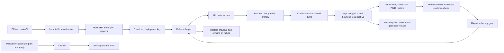

# NASJ infrastructure qualification

## Audit and disposition

- **Verified.** The merged production pipeline passed hosted CI and built its native release. The deployment job was skipped. Main has the required aggregate check. The production Environment restricts deploys to main.
- **Verified.** FelCloud is x86-64 Ubuntu with Node 24.20.0 and PostgreSQL 16. API, web, worker, and Certbot timer were active. Nginx syntax validation passed. The server reported 65 GiB free on the release filesystem. UFW was inactive and provider rules remain unverified.
- **Verified recovery evidence.** An initial Neon snapshot was restored back into an isolated PostgreSQL 16 cluster. Neon runs PostgreSQL 18. A matching PostgreSQL 18 export client was required. Live application database settings have remained on FelCloud.
- **Partial.** Runtime and migration role separation exists. Runtime lacks read access to Prisma migration history. The deployment scripts are merged, but the VPS still has its original real application directory and needs production qualification.
- **External.** A dedicated local backup volume, Age key custody, alert routing, and protected infrastructure credentials still need production configuration. No production apply, cutover, scheduled backup, or migration was performed during implementation.

## Architecture and decisions



Ansible installs configuration and canonical scripts. systemd schedules operations and supervises
the application. The production helper owns artifact authorization, switching and rollback.
Continuous delivery builds releases automatically. Production activation still requires host
authorization of the digest. A future automatic authorization design should verify a trusted
build attestation for the artifact, commit, repository, workflow and main ref using an independent
trust root. Transport credentials must never authorize their own uploads. Application rollback
retains the compatible expanded database schema.

Neon refresh creates a uniquely named database and validates migration checksums and every public
table's row count against the verified restore of the same dump. The pointer changes only after
verification. Existing copies and failed candidates are retained for operator review. Use a
dedicated Neon project and a role with CONNECT and CREATE DATABASE. Never configure the production
app to use the recovery endpoint. A portable PostgreSQL 16 archive is the preferred VPS recovery
source. Neon-native exports require a client at least as new as Neon.

## Configuration matrix

| Setting | Location | Purpose and state |
|---|---|---|
| `DEPLOY_HOST`, `DEPLOY_PORT`, `DEPLOY_USER`, `DEPLOY_SSH_KEY`, `DEPLOY_KNOWN_HOSTS` | GitHub production Environment | Exists by name. VPS restricted access still needs qualification. |
| `PRODUCTION_DEPLOY_ENABLED` | GitHub repository variable | Unset during qualification. |
| `INFRA_WORKFLOW_ENABLED` | GitHub repository variable | Unset pending infrastructure workflow qualification. |
| `INFRA_SSH_KEY`, `INFRA_KNOWN_HOSTS`, `INFRA_EXTRA_VARS` | Protected production-infrastructure Environment | Missing. Use a dedicated infrastructure user/key and trusted known_hosts. |
| `ansible_host`, `ansible_user`, `nasj_public_health_url` | Private Ansible extra vars | Supply actual endpoint, account and address. The tracked inventories contain placeholders. |
| `nasj_deploy_config` | Vault vars | Reviewed deploy config from the template. Existing file is preserved. |
| Runtime and migration env files | `/etc/nasj/runtime.env`, `/etc/nasj/migration.env` | Provision privately from the existing config, with separate owner groups. |
| `BACKUP_DATABASE`, `BACKUP_MAX_MIB`, `NEON_REFRESH_ENABLED` | Vault map entry `nasj_backup_files['backup.conf']` | Set the existing database name, archive limit (default 256 MiB), and enable nightly Neon refresh in production. A migration always requires Neon. |
| `nasj_backup_volume_uuid` | Private Ansible extra vars | UUID of a preformatted, capacity-bounded ext4 filesystem. Required for the opt-in mount playbook. No formatting is performed. |
| Age public recipients and restore identity | Vault map entries `backup.recipients`, `backup.identity` | Missing. Keep an independent recovery key copy outside the VPS. The production verifier requires a private identity to check its round trip. |
| `PGHOST`, `PGUSER`, `PGDATABASE=neondb` | Vault map entry `backup-neon.conf` | Existing recovery destination. Direct endpoint and verified TLS required. |
| Dedicated Neon password entry | Vault map entry `backup-neon.pgpass` | Supply securely. Use a database wildcard for newly named candidate databases, restricted to the exact Neon host and role. |
| HTTPS alert target and authentication | Vault map entry `notify.curl` | Missing. Supply a protected curl config with `url` and any auth headers. |

The selected storage is a private encrypted local filesystem at `/srv/nasj-backups`.
A loopback S3 service could reuse the old client abstraction but would add a server,
authentication and lifecycle configuration, a network listener, and resource overhead.
It would share the VPS failure domain either way. The filesystem creates no storage endpoint,
API or administrative interface, and removes the need for AWS credentials. Root owns archive
directories and files. The disposable restore account can write only its private workspace.
Do not configure the proposed port 9000 or buckets.

Use a dedicated, capacity-bounded filesystem with `nodev,nosuid,noexec,nofail`. Prefer a
separate block volume; an existing, fully preallocated image is an alternative only if its
capacity can be reserved without compromising the database filesystem. Never use an
unbounded sparse production file on the database disk. The backup refuses the PostgreSQL
filesystem and refuses to proceed if the mount is absent. The dump streams directly into Age encryption. Encrypted scratch files and temporary restore
clusters use the same bounded mount. The operation requires free space equal to at least six
times the configured per-file limit plus 512 MiB. Start by reserving 8 GiB for the current
small workload, measure growth and increase only after checking host capacity.

Retention treats daily, weekly, monthly and pre-migration archives independently with 30,
84, 183 and 30 days respectively. It considers only complete backup pairs and leaves the
newest verified pair per class. Review incomplete artifacts and obsolete Neon candidates
separately. The Neon refresh never drops a previous recovery database.

**Full VPS loss also loses the local archive history.** Neon is the only off-host database
recovery destination in this design. Its latest verified database is the recovery point.
If both FelCloud and Neon are inaccessible, this setup cannot recover the database. A same-host
receipt never qualifies a migration. The hook creates a new Neon database from the exact
current snapshot, compares restored table and migration evidence, and publishes a release-bound
off-host receipt only on success. Keep the current Neon project and recovery access recorded
outside the VPS. The production PostgreSQL data and Nginx/systemd service lifecycle are
independent of backup mount or Neon failure.

Configure an external heartbeat to detect loss of the host. The local monitor checks TLS,
applications, database, CPU load, memory, disk, local and off-host backup freshness, and
unfinished deployment state. Alerts need an operator-approved destination.

## Ordered operator qualification

From `infrastructure/ansible`, install `requirements.txt` into an isolated Python environment.
Prepare encrypted extra vars via `ansible-vault create /secure/nasj-production.yml`.
Supply the host address and trusted host SSH entry. Keep an independent administrator session and
provider console access before authorizing SSH changes.

```bash
ansible-playbook -i inventories/production/hosts.yml --ask-vault-pass \
  -e @/secure/nasj-production.yml playbooks/audit.yml
ansible-playbook -i inventories/production/hosts.yml --ask-vault-pass \
  -e @/secure/nasj-production.yml playbooks/configure.yml --check
```

1. Reserve and format a dedicated ext4 volume outside the PostgreSQL filesystem. Record its
   UUID. After separate mount approval, run `playbooks/mount-backup.yml` with
   `nasj_confirm_backup_mount=true` and the reviewed UUID. Verify `findmnt /srv/nasj-backups`.
   Review retention, Age key custody, Neon access and the notification route.
2. After explicit production apply authorization, rerun configure with
   `-e nasj_production_apply=true`. Qualify the restricted key and preserved SSH access
   separately before setting `nasj_reload_ssh=true`. Inventory-specific Nginx, TLS and systemd
   configuration remains in place. Do not paste generic replacement files over existing ones.
3. After approving the read grant, run `playbooks/database-grant.yml` with
   `nasj_confirm_database_grant=true` and the verified database/runtime/migration identifiers.
4. Run `playbooks/backup.yml` with `nasj_run_backup=true`. Require
   `NASJ_BACKUP_READY`, a matching local manifest and successful isolated restore. Require a fresh Neon
   receipt and test recovery from that database before enabling deployment. Run the backup twice and validate alarm delivery using a
   separate staging destination before enabling `nasj_enable_backup_timer` and
   `nasj_enable_monitoring`.
5. Review the artifact and approve a maintenance window. Run `playbooks/adopt-release.yml`
   with `nasj_confirm_adoption=true`, then `playbooks/verify.yml`. The adoption script requires
   a fresh verified backup, deployment lock, filesystem and capacity checks. An interrupted
   adoption retains the original and candidate paths in the pending marker.
6. Authorize the reviewed release digest as documented in [the deployment runbook](deployment.md).
   Enable CD only after host qualification, test one compatible release and separately exercise
   rollback. Verify public readiness and worker operations before declaring readiness.

For GitHub infrastructure automation, create the protected Environment and configure review
permissions independently of the application Environment. Run the workflow in plan mode on main,
review its result, then dispatch apply with the successful matching plan run ID. The workflow
runs fresh check mode before apply. Keep the flag unset until the protected Environment and
separate management credentials have been validated. A syntax-valid check run is not an
operational rehearsal.

## Replacement VPS recovery

Use a separate recovery inventory and `playbooks/bootstrap.yml` with
`nasj_confirm_bootstrap=true`. Recreate the approved runtime, migration, and monitoring roles,
and load the off-host copies of the real configuration, pinned Node runtime, trusted SSH host
records, credentials, PostgreSQL extension inventory, and DNS/TLS details. Preserve an off-host
encrypted copy of role grants/settings and archive a known-good application artifact beyond
GitHub Actions artifact expiry. The data backup excludes ownership and ACLs by design.

For complete VPS loss, use the latest verified Neon database. Export with a client matching
Neon and test on disposable PostgreSQL 16 before starting recovery. Create a PostgreSQL 16 custom-format dump from that validated restore for the recovery playbook. If the local archive
volume survived, check the Age archive SHA-256 and decrypt in a protected location. Then run `playbooks/disaster-recovery.yml` against an isolated
recovery inventory, with `nasj_confirm_restore=true`, `nasj_recovery_database=nasj_recovery_drill`, and the protected dump path. Confirm extensions, runtime grants,
application login/read/write smoke behavior and outbox handling before routing traffic. Start
the known-good app and worker only after verifying backup compatibility. Restore DNS, test public
TLS, and resume backups and alerting. Review potential duplicate background work before starting
the worker.

Initial RPO target is 24 hours, subject to successful nightly runs. Full VPS-loss RTO is
unmeasured. Record stage timings in the first replacement-host rehearsal. If lower RPO is
required, add periodic physical base backups and continuous encrypted WAL archiving with
restore-to-time drills. Neon restore history only covers the copy uploaded to Neon.

## Persistent qualification checklist

- [x] Read-only server audit and historical Neon recovery proof.
- [x] Deployment fault suite and disposable PostgreSQL evidence test.
- [x] Ansible syntax and inventory validation on local tooling.
- [x] P0 implementation: same-host archive, retention and independent migration gate.
- [x] P0: Qualify the bounded archive filesystem and mount idempotency in the Ubuntu VM.
- [x] P0: Exercise a real remote refresh against a separate synthetic Neon database or project.
- [x] P0: Validate full local archive pipeline and Ansible idempotency on disposable Ubuntu 24.04.
- [x] P0: Exercise synthetic adoption, restricted SSH deploy, rollback, alert, and recovery in the VM.
- [ ] P0: Qualify dedicated infrastructure and deploy SSH, backup credentials and alerts.
- [ ] P0: Authorize and qualify live backup, restricted access, adoption, first deploy and rollback.
- [ ] P1: Measure full recovery time and archive known-good releases and host config off-site.
- [ ] P2: Automate trusted provenance-based release authorization and evaluate WAL archiving.


## Validation record

| Check | Environment | Expected and observed result | Status |
|---|---|---|---|
| Existing deployment fault suite | Local temporary shell fixtures | Unauthorized artifacts, bad digests, lock contention, signal interruption, backup failures and restart/readiness/worker rollback were handled as expected. | Passed |
| Backup orchestration | Temporary filesystem and fake storage/restore adapters | Nightly and migration success, missing mount, failed write, invalid restore, failed Neon refresh and wrong Neon receipt passed. A same-host receipt alone cannot authorize migration. | Passed |
| Backup evidence | Local isolated PostgreSQL 16 Docker container | Matching restore returned identical evidence. Removing a row changed evidence. An unfinished migration failed the check. | Passed |
| Ansible inventory and syntax | Both checked-in sample inventories | Inventory parsing and playbook syntax completed. | Passed |
| ShellCheck, actionlint, YAML and Ansible lint | Local static checking | Scripts and workflows passed the checks run. | Passed |
| Systemd schedule | Local systemd calendar parser | The daily UTC trigger parsed. | Passed |
| VM boot and dedicated storage isolation | Ubuntu 24.04.5 minimal cloud guest on KVM | Verified image digest, successful cloud-init, pinned host key, separate ext4 archive device and restrictive mount options. | Passed |
| S3 upload and download | Not selected | Local filesystem opens no listener and requires no S3 account. | Not applicable |
| Dedicated volume provisioning and repeat apply | Disposable Ubuntu 24.04.5 guest | The storage role changed 2 tasks then 0 on the second run. UUID-based mount persistence changed 1 task then 0 on the second run. Neither run failed. | Passed |
| Full Ansible configuration idempotency | Disposable Ubuntu 24.04.5 guest | Second configure returned 28 OK, zero changed, and zero failed. | Passed |
| Local encrypted archive, retention and timer | Ubuntu guest, real Age, PostgreSQL 16 and systemd | The service wrote a valid encrypted backup receipt after a real isolated restore, retention kept its pinned pair and removed an expired pair, and the nightly timer scheduled successfully. | Passed |
| Restricted SSH and authorized release lifecycle | Ubuntu guest, synthetic release and real systemd/Nginx/TLS | Arbitrary command rejected, adoption succeeded and repeated cleanly, authorized candidate deployed, and worker failure restored the prior healthy release. | Passed |
| Recovery guard and invalid configurations | Ubuntu guest | A pending marker blocked the next release and was reconciled. Invalid Nginx, systemd and SSH files were rejected without affecting running services. Missing backup mount blocked backup while PostgreSQL still returned the fixture row. | Passed |
| Alert and database recovery | Ubuntu guest, test HTTPS receiver and synthetic database | Alert POST reached the receiver and returned 204. The archive restored into an isolated database and returned the expected fixture row. | Passed |
| Pre-migration off-host failure gate | Ubuntu guest and disposable mock tests | A real local archive with no Neon config failed the migration command and wrote no off-host receipt. Wrong remote receipts and failed refreshes also failed in the mock suite. | Passed |
| Fresh Neon recovery point from the new hook | No synthetic Neon destination connected to the VM | The earlier production Neon copy and independent restore remain valid historical evidence. The new candidate automation has not written to production Neon during this qualification. | Pending |
| Live rollback, artifact deployment, full disaster recovery timing | Production changes not authorized | Perform only after staging qualification and a verified remote recovery point. | Pending |

The application workflow still publishes and verifies the same artifact ID and checksum. Treat
a run that became superseded as a deliberate operator decision. Approve only the intended
reviewed digest, and revoke any unused release authorizations. Reuse the original artifact for
a retry. A rebuilt bundle requires fresh authorization even if its source commit matches.


## Local VM qualification

The development workstation has KVM, 12 logical CPUs, 15 GiB RAM and over 300 GiB
available on its workspace filesystem. Qualification booted a QEMU/KVM Ubuntu 24.04.5
guest with 2 vCPUs,
3 GiB RAM, a 24 GiB sparse OS image and a separate 8 GiB sparse test backup image.
The sparse devices are appropriate for the disposable workstation guest only.
SSH forwards on workstation loopback to guest port 22. The seed injects a unique
host key and the launcher writes a matching known_hosts file. The guest verified a
separate 7.8 GiB-formatted ext4 archive device with all three restricted mount flags.

Download the official Ubuntu 24.04 minimal amd64 cloud image and its SHA256SUMS
over HTTPS and verify the image before launching. Use a private work directory
outside the Git tree:

```bash
python3 -m venv /path/to/private-vm-tools
/path/to/private-vm-tools/bin/pip install -r infrastructure/staging/requirements.txt
/path/to/private-vm-tools/bin/python infrastructure/staging/prepare-vm.py \
  /path/to/verified-ubuntu.qcow2 /path/to/new-private-nasj-vm
```

Wait for `cloud-init status --wait` using the generated admin and pinned host key.
Run `bash infrastructure/staging/qualify-vm.sh /path/to/new-private-nasj-vm` from the
repository root. The harness provisions Ubuntu, configures twice, checks restricted SSH,
and exercises TLS health, Age archive recovery, retention, alerts, adoption, a synthetic
artifact switch and rollback, the recovery marker, and missing-mount handling. It uses a synthetic receipt only
after proving that a local archive does not pass the migration gate. A synthetic Neon branch/project and credential are required
for real remote integration. Never use the production recovery copy for fault injection.

## Production readiness audit, 2026-11-24

FelCloud still runs the original real release directory. API, web, worker, PostgreSQL,
Nginx and the Certbot timer were active. Nginx configuration validated and public
readiness returned `ready`. Only the 80 GiB VPS disk was visible. `/srv` and
`/var/lib/postgresql` share its root ext4 filesystem with 65 GiB free. No dedicated
backup block device is visible. Prefer requesting a separate volume. An explicitly
reserved, fully preallocated image is an alternative if the provider cannot attach
one and an operator reviews the capacity impact. Never mount an unbounded sparse
image on the production database filesystem.

The runtime and migration DB roles point to the same database and are distinct.
Neither has superuser, database-creation or role-creation rights. Only the migration
role can create in the public schema. The runtime role still needs SELECT on
`public._prisma_migrations`. PostgreSQL reported 19,364,887 bytes in the production
database. The new instrumentation measured a 2,501-byte encrypted synthetic archive in
3 seconds on the guest. The historical production Neon drill did not record archive size or
RTO. The live database size is not an archive measurement. No production dump
was taken for this audit. Existing runtime and migration secret files are 0640 and
0600 respectively and remain in place.

SSH listens on 22, permits public keys, disables password login, and permits public-key
root login and forwarding globally. The dedicated restrictions must be installed and
validated separately. UFW is inactive and the host reported no nftables tables. Provider
firewall controls and out-of-band recovery access still need confirmation. GitHub protects
main with the strict required workflow check and admin enforcement. The production
Environment restricts deployment to main and has the SSH credential entries. The
separate protected infrastructure Environment is absent. Both deployment flags are unset.

### Production storage activation

The separately authorized 20 GiB FelCloud data disk was formatted as ext4 and mounted
persistently by Ansible at `/srv/nasj-backups`. The mounted filesystem had 19 GiB
available with `nodev,nosuid,noexec`; PostgreSQL remained on the original root
filesystem with 65 GiB available. API, web, worker and PostgreSQL were active after
the mount. A subsequent read-only Ansible audit passed. This step did not configure
backup credentials, enable timers or activate deployment.

### Activation preflight follow-up

Base deployment helpers and the scoped sudo rule are installed. PostgreSQL 16.15,
the API, web, worker and Nginx were active. The backup mount remains isolated on
`/dev/vdb`; PostgreSQL is on `/dev/vda1`. The reviewed candidate `d63a7aa` matched
all 44 production migration names and checksums; the fresh audit also found zero
unfinished, non-rolled-back migrations. The migration table still has no explicit
runtime SELECT grant. The dedicated SSH user has no forced command or forwarding
restriction in the effective configuration. Console recovery access is unverified.

The release config and separate runtime and migration env files are absent. The
backup config, Age identity and recipients, direct Neon config and password file,
and alert config are absent. The existing production Neon recovery config is held
privately on the operator workstation. Synthetic Neon config is held separately.
The canonical off-host receipt is absent. Both automation flags remain unset.

### Neon remote qualification and retention

The private synthetic connection is available. Its direct hostname was derived
from the saved pooled URL and checked against the existing recovery hostname before
use. The real Ubuntu guest hook exposed inherited Neon channel binding at the local
peer-authenticated dump. The canonical backup script now clears the inherited
connection settings before the local dump. The retry passed encryption and local
PostgreSQL 16 restore (2,501 bytes, 4 seconds to local publication). A separate
verified-TLS connection probe from the guest timed out; workstation TCP port 5432
was reachable. The subsequent direct TLS guest test qualified the baseline receipt and reverse recovery. No production
database or existing recovery point was modified.

The old production recovery database remains a verified historical copy and was
excluded from testing. To reproduce the test, use a separate direct endpoint with
a role allowed to connect and create databases. On the Ubuntu guest, install the
updated scripts and provide root-only `backup-neon.conf` and
`backup-neon.pgpass` through private Vault vars. Run as guest root:

```bash
bash qualify-neon.sh SYNTHETIC_DIRECT_HOST PRODUCTION_DIRECT_HOST
```

Connectivity follow-up: both the workstation and Ubuntu guest resolved IPv4 and IPv6
addresses and had default routes. Bounded socket probes connected to TCP 5432 on
both address families, but the PostgreSQL SSLRequest (8-byte packet, code 80877103)
received no response within 3 seconds on either machine. Bounded
`openssl s_client -starttls postgres -verify_hostname HOST -verify_return_error`
probes also timed out. The current helper timed out during Neon refresh after
roughly 63 seconds. TLS certificate validation, authentication and SQL were never
reached. The guest NAT alone cannot explain the failure; the upstream cause is
unconfirmed. Do not relax TLS or channel binding.

Independent probes on 2026-11-24 around 20:02 UTC against the direct synthetic
endpoint in AWS `us-east-2`:

| Source | DNS / TCP 5432 | Traditional SSLRequest | Direct TLS with PostgreSQL ALPN | Certificate / hostname | Authentication / SQL |
| --- | --- | --- | --- | --- | --- |
| Workstation | Resolved / connected | Timed out in 6 seconds | TLS 1.3 | Verified | PostgreSQL 18.7 authenticated with channel binding required, executed SQL and confirmed CREATEDB |
| Ubuntu KVM guest | Resolved / connected | Timed out in 6 seconds | TLS 1.3 | Verified | Guest PostgreSQL 18.7 completed a verified remote restore and executed evidence queries |
| FelCloud | Resolved / connected | Negotiated TLS 1.3 | TLS 1.3 | Verified in both modes | Not attempted; credential-free network probe only |

The difference is specific to traditional negotiation over the development network.
Direct TLS and FelCloud's traditional negotiation both work at the transport layer.
The device dropping or withholding the traditional response is still unidentified.
Neon's public status page listed AWS us-east-2 database connectivity as operational
when checked. Account-level compute and access policy were not inspected. No
GitHub runner was configured or supplied with credentials. An independent hotspot
would help isolate the workstation network; current evidence does not justify a
permanent transport change.

GitHub confirmed artifact ID `14918288458`, name `production-release-1`, size
263,566,244 bytes, and the exact reviewed commit. The private workstation copy passed both digest checks and canonical safe
extraction. The extracted manifest confirmed the exact commit, Linux x64 and
Node v24.20.0. ZIP SHA-256: `1a206cbe2fd8a3ef884b60431132fcb04fbd14879185fc58eb8cb401cffc9b18`.
Bundle SHA-256: `1baa090ab7430db0665e0fc5a45c7c5c480ae4a79aa3b246ba871b51329ed5e5`.

The local connection-isolation regression
(`bash infrastructure/staging/check-backup-connection-isolation.sh` as guest root)
passed the real backup and isolated restore with invalid host, port, user, database,
password, service, SSL and PostgreSQL options inherited from the caller.
That local-only test does not generate a fresh off-host verification receipt.

The script requires the separate endpoint, runs the real pre-migration hook against a
synthetic database, checks evidence and the remote receipt, and verifies that a deliberately
invalid candidate has no receipt and cannot replace the local recovery pointer. It retains
both candidates. Export the verified candidate using a PostgreSQL client at least as new
as the remote server. Restore into a disposable PostgreSQL 16 database using the documented
compatibility procedure and compare the evidence and its synthetic fixture row. Record the
actual archive bytes and duration from `latest-offsite` and independently measure the
recovery time. The remote `nasj_recovery_metadata.receipt` table makes the successful
candidate and release association discoverable even if the VPS is lost.

Start with the newest seven verified daily candidates, four weekly candidates, three
monthly candidates, and a pinned known-good point and any release-bound candidates still
needed for an incident. Review database size and Neon plan usage weekly before changing
the policy. Account for full logical copies, Neon history retention, and failed candidates
separately. An operator must independently verify a newer restorable copy and obtain
approval before any deletion. No pruning of Neon databases is automated. Local retention
continues independently. Total VPS loss removes all same-host history.

### Guest remote qualification and transport

The disposable Ubuntu guest now has PostgreSQL 16 for local dump, verification and
restore, plus PostgreSQL 18.7 client tools for remote direct TLS. Installing the
second client exposed an unqualified `pg_restore` invocation: the newer wrapper
sent `SET transaction_timeout` to PostgreSQL 16. The local verifier now uses explicit
PostgreSQL 16 executables. The remote helper defaults to traditional negotiation
using PostgreSQL 16; the test-only `NEON_SSL_NEGOTIATION=direct` configuration
selects PostgreSQL 18. Both paths require hostname and CA verification and channel
binding. There is no automatic fallback.

The canonical guest hook created and verified a 2,501-byte encrypted archive and
published a release-bound Neon receipt in 21 seconds (3 seconds to local
publication). The full test, including a failed candidate with intentionally
mismatched evidence, took 49.7 seconds. The earlier verified receipt remained
unchanged and the failed remote candidate had no receipt. PostgreSQL 18 exported
the verified candidate and disposable PostgreSQL 16 restored and matched its
table and migration evidence in 22 seconds. A repeat with 25,000 additional
synthetic rows produced a 7,415,401-byte encrypted archive; local publication took
3 seconds and the off-host receipt took 103 seconds total (100 seconds after
local publication, including remote creation, transfer, restore and verification).
The full test including failure preservation took 174.1 seconds. CPU time for
the driving shell and children was 1.68 seconds user and 0.34 seconds system;
a sample during the reverse restore showed 343 MiB used in the 3 GiB guest.
The larger reverse restore matched evidence in 198 seconds. Peak memory and
separate upload/verification timings were not measured.
Only synthetic data was used. The read-only production Ansible audit passed
with no changes; the full check-mode plan awaits the production Vault inputs.
The original restricted SSH and activation gates remain unchanged.

For production approval, run the playbooks from `infrastructure/ansible` with the
production inventory and a private Vault file. The approval packages are:

- **A — Infrastructure:** Review `configure.yml --check --extra-vars @VAULT` with
  backup enabled and timer activation off. Apply with
  `-e nasj_production_apply=true` only after consent. Keep SSH configuration and
  reload off until independent console access is verified and the SSH change is
  authorized. Review `database-grant.yml -e nasj_confirm_database_grant=true`
  separately. Only the runtime migration-history SELECT grant is intended.
  Validate services, mount and permissions; preserve prior configuration for
  rollback. The existing 20 GiB disk must not be reformatted.
- **B — Backup qualification:** After approval run
  `backup.yml -e nasj_run_backup=true`, recover the fresh candidate independently,
  compare archive and remote evidence, and verify the canonical receipt is less
  than 24 hours old. Preserve all previous Neon candidates. A failed run or
  mismatched evidence stops activation; it must not be repaired by editing receipts.
- **C — Cutover:** After separate maintenance approval, run
  `adopt-release.yml -e nasj_confirm_adoption=true`; then authorize and deploy the
  digest-bound artifact per the deployment runbook. Verify API, web, worker and
  public HTTPS, and exercise rollback to the retained compatible prior release
  under the deployment lock. Reconcile the release state before enabling CD.
  Schedule and confirm backup and monitoring runs, with separately approved
  activation and flags. No production mutation was executed for this phase.

### Production activation approval steps

1. Review and merge the infrastructure PR after the required aggregate check passes. It includes the reusable infrastructure workflow as well as application and security checks.
2. Authorize the dedicated filesystem. Prepare the approved capacity-bounded ext4 device,
   collect its UUID, and run `mount-backup.yml -e nasj_confirm_backup_mount=true` with the
   UUID in private vars. Verify the mount options and distinct device with `findmnt`.
3. Approve Age key custody, the existing Neon recovery project and its dedicated access role,
   and a production HTTPS alert destination. Enter the encrypted Vault vars privately using
   the configuration matrix. Keep independent access to the recovery key and Neon account.
4. Run `audit.yml` then `configure.yml --check` using those vars. Review the resulting plan.
   After explicit authorization, run configure with `nasj_production_apply=true`. Keep the
   timer and SSH reload booleans off during this first apply.
5. Separately authorize `database-grant.yml -e nasj_confirm_database_grant=true` with the
   verified runtime and migration identifiers. Confirm runtime SELECT and no schema CREATE.
6. Run `backup.yml -e nasj_run_backup=true`, then independently recover the new Neon copy into
   PostgreSQL 16. With explicit backup-write authorization, invoke the installed
   `/etc/nasj/backup-before-migrate FULL_CANDIDATE_SHA` and require the matching local and
   remote receipts. This hook invocation creates a backup only. It does not run migrations.
7. Verify monitor and alert delivery. Approve turning on `nasj_enable_backup_timer` and
   `nasj_enable_monitoring` in a reviewed configure apply. Check `systemctl list-timers`
   and require a successful real scheduled run.
8. Preserve console access. Separately authorize the deploy SSH drop-in, reload and key test.
   Qualify denied arbitrary commands and confirm the independent admin session still works.
9. Authorize the maintenance window and `adopt-release.yml -e nasj_confirm_adoption=true`.
   Run `verify.yml` and retain the original application release.
10. Download the exact reviewed Actions artifact with `gh run download RUN_ID -n ARTIFACT_NAME`.
    Compare its SHA-256 with the reviewed build summary. Write the authorization file as in the
    deployment runbook. With separate deployment approval, send that exact archive through the
    forced SSH command, check API/web/worker and public health, and rehearse app rollback with
    approved compatible releases. Set the CD flag only after these checks pass.
11. Create the separate protected infrastructure Environment with main-only branch restrictions,
    protected approval and its own credentials. Qualify plan mode before any apply dispatch.
    Enable the infrastructure flag only after explicit authorization and that qualification.

No production mutation, off-host write, deployment activation or provider change was made
during this readiness audit.

### Package A preparation

See [Package A](production-package-a.md) for the A1–A4 commands, credentials,
verification and rollback. The workstation has an encrypted Vault starter with
host, UUID, role names, deploy and backup defaults. A dedicated production Age identity and recipient are now in Vault; independent
operator recovery custody remains to be confirmed. The existing production Neon
credential was staged separately from qualification. A read-only verified-TLS
probe confirmed CONNECT and CREATEDB without creating or changing a database.
The approved alert destination, console access and provider firewall review
remain operator inputs. Strict administrator SSH and public HTTPS readiness passed;
the application services and PostgreSQL remained active. No production apply,
database grant, SSH reload, notification or timer activation was performed.

Backup flow (nine scenarios), retention, real PostgreSQL evidence, deployment
faults, forced command rejection, schema gates, and tracked-history secret
scanning passed. The preserved artifact still matches the head of main at this
review; merge the infrastructure-only PR after required CI passes and retain the
reviewed artifact for the separately authorized first cutover.

The Vault-backed production plan with backups enabled completed with 21 OK,
10 predicted changes, 10 skipped, and zero failures. It previewed deploy.conf,
the archive mount-root permission change to 0711, private archive and restore
directories, Age installation with package service autostarts suppressed,
the unprivileged restore account, protected backup settings, canonical scripts,
and inactive systemd units. It did not include the SSH role or alert config.
The separate database-grant dry run passed its assertions and skipped SQL
execution; the live read-only query returned false for both migration-history
SELECT and public-schema CREATE for nasj_app. No grant was executed.

The operator selected Discord for A4. The notifier supports Discord content with
mentions disabled and retains generic HTTPS. Isolated HTTPS mock tests cover both
formats, certificate rejection and retry limits. Discord mode and production
environment are staged in the encrypted Vault; the private webhook URL,
independent Age custody and recovery-console/firewall confirmation are still
required before the combined dry run. No live alerts were sent.

After the operator confirmed independent Age recovery custody, console login
with sudo, and provider firewall review, the combined Package A structural dry
run completed with 25 OK, 13 proposed changed tasks, six skipped, and zero
failures. It included backup, restricted SSH files, and Discord configuration,
with SSH reload and timers explicitly disabled. The private local URL check
still rejected the saved webhook value; check mode does not validate delivery
or the credential. Package A4 remains blocked on a valid replacement URL.
PR #258 at 3546a4c passed the required hosted check and remains draft.
No production changes were applied.

After the replacement Discord webhook was saved, its URL and Discord mode passed
local validation without contacting Discord. The combined production check mode
was repeated with the corrected Vault: 25 OK, 13 proposed changes, six skipped,
zero failures. Operator confirmations for Age custody, recovery console with
sudo, and provider firewall review remain recorded. The alert delivery itself
is not yet qualified; it needs separate approval after configuration is applied.
Both production automation flags remained unset. Package A is at the approval
boundary; no production apply, grant, reload or alert was executed.

### Authorized A1/A4 installation

The approved `3546a4c` implementation was applied with only backup and notification
configuration enabled. Ansible returned 23 OK, 10 changed, eight skipped and
zero failures. The only installed package was Age; PostgreSQL was not upgraded.
The existing env files were copied without overwriting either destination.
Original env, fstab and sudo-policy checksums and the monitored service start
times remained unchanged. Public readiness returned ready. The backup mount
retains 19 GiB free on its independent ext4 filesystem; PostgreSQL retains
65 GiB free on root. Systemd unit verification succeeded with an IPv6 availability
warning, and the installed backup, monitoring and notifier units remained inactive.
Discord config passed local structural and permission checks; no request was sent.

The same-scope check-mode rerun returned 21 OK, zero changed, 10 skipped and zero
failures. The protected rollback snapshot and restore instructions are in the
[Package A runbook](production-package-a.md). A2, A3 and live notifier delivery
remain separate approvals. Neither automation flag was set and Packages B
and C were not started.

### Package A operational qualification

A2 added exactly non-grantable SELECT on the Prisma migration history table to
`nasj_app`, leaving public-schema CREATE false. The history checksum was
unchanged. A3 installed the two restricted SSH files and their root-owned key
directory; key matching, sudo and SSH syntax checks, and the on-disk effective
policy passed. SSH was not reloaded and its daemon state was unchanged. The
[Package A runbook](production-package-a.md) records the rollback snapshot,
exact reload command and post-reload verification. Live restricted SSH
qualification remains pending separate reload authorization.

The canonical notifier sent one labeled qualification test. Discord returned
HTTP 200 over verified TLS, with mentions disabled by the reviewed formatter.
Operator receipt confirmation is pending. Backup and monitoring timers remained
disabled. The systemd IPv6 warning was reproduced without a unit validation
failure: the current kernel has no IPv6 interface addresses or IPv6 web
listeners. IPv4 public HTTPS readiness and actual outbound Discord delivery
passed. This is not a blocker for the operations tested, but no IPv6 path is
qualified. All production services remained active, service start times
matched the prior snapshot, and the backup filesystem remained distinct from
PostgreSQL. Neither automation flag was set. Packages B and C were not started.

A3 live SSH qualification passed after the authorized reload. The operator
confirmed an open recovery console with sudo; a separate admin session was
held. Fresh strict-host-key administrator login and sudo passed. The dedicated
key authenticated, arbitrary command execution was denied by the forced
command, PTY and forwarding probes were denied, and the server offered
public-key authentication only. No read-only deployment verb exists, so no
artifact or deploy command was sent. No rollback was required. Production
services and IPv4 public HTTPS remained ready; timers and both automation
flags stayed disabled. The read-only kernel audit found historical soft
lockups/RCU stalls but none in the preceding 12 hours and no failed units.
The latest event was at 00:56:46 UTC on 2026-11-24, with a virtio GPU/framebuffer
stack. Root cause remains unconfirmed. The Package B authorization plan is
in the runbook; no production backup or Neon refresh was started.

### Package B production backup and independent recovery

The one-time authorized backup ran through `playbooks/backup.yml -e
nasj_run_backup=true`: three OK, one changed, zero failures. The preflight
database size was 19,389,463 bytes and the backup mount had about 19 GiB free.
There were no pre-existing local archives to prune. The canonical operation
produced a 3,606,110-byte Age archive. SHA-256 verification passed. Local
publication took 5 seconds including the canonical isolated restore. A
separately timed repeat restore of the encrypted archive into disposable
PostgreSQL 16 took 4 seconds. Off-host receipt publication took 160 seconds
total, roughly 155 seconds after local publication (create, transfer, restore
and verify combined; transfer-only timing was not collected).

A new candidate in the existing production Neon project matched both the remote
receipt and the canonical local snapshot evidence:
`NASJ_EVIDENCE:146:44:cb7d1f4de78d04e0c28e2fa6623372c0:8491d197a86b3513ae76a62a039d8b43`
(146 public tables, 44 applied migrations, migration digest and row-count
digest). An independent PostgreSQL 18 export and disposable PostgreSQL 16
restore on FelCloud matched that evidence in 30 seconds. The disposable
cluster and temporary client tooling were removed. Production data was not
sent to the workstation. The canonical adoption receipt was root-only, and
its archive digest, size, release marker and evidence matched the manifest and
remote receipt. It was published 2026-11-24 22:56:25 UTC (23:56 in Tunisia),
and is eligible through 2026-11-25 22:56:25 UTC (23:56 in Tunisia), subject to
the adoption gate. No previous recovery database was deleted or overwritten.

Across 72 monitoring samples, minimum available memory was 2,696 MiB; maximum
sampled CPU use was 50%, steal 1%, I/O wait 6%, and disk read/write rates were
208/4,620 KiB/s. There were no matching kernel warnings or failed health
samples. API, web, worker, PostgreSQL and Nginx were active before and after;
public HTTPS was ready and service start times were unchanged. The backup
oneshot finished successfully and returned inactive. Both timers and
automation flags remain off. The historical CPU stall risk remains under
observation. No migrations, adoption or deployment occurred.

### Package C authorization proposal

The proposed artifact is the already verified release `d63a7aa`,
artifact 14918288458, bundle SHA-256
`1baa090ab7430db0665e0fc5a45c7c5c480ae4a79aa3b246ba871b51329ed5e5`.
The bundle digest was rechecked and 44 migration checksums still match live.
Main advanced to `6f9454f` when PR #258 merged; its CI and release passed and
deployment was skipped. The delta is infrastructure/docs only, so the
preserved application artifact is still the concrete proposed target.
Choosing the newer artifact instead requires independent archive and bundle
verification and specific authorization.

In the approved maintenance window, recheck readiness, kernel health,
receipt freshness and exact artifact identity. With the existing Vault
command prefix, run `playbooks/adopt-release.yml -e
nasj_confirm_adoption=true`. It retains the current release for rollback
and restarts API, web and worker during adoption. Then write the exact
digest authorization in `/etc/nasj/releases/FULL_SHA` following the
deployment runbook and send the preserved bundle via the qualified
forced-command SSH identity:

```bash
ssh -o BatchMode=yes -o IdentitiesOnly=yes -o StrictHostKeyChecking=yes \
  -i PATH_TO_DEPLOY_KEY -l nasj-deploy nasj \
  'deploy d63a7aad49c3c8befded53cba334ab5c81477ab5 sha256:1baa090ab7430db0665e0fc5a45c7c5c480ae4a79aa3b246ba871b51329ed5e5' \
  < ~/.local/share/nasj-release.qVHh1s/release.tar.gz
```

Verify the release link, local API/web, worker status and public readiness.
Under the deployment lock, exercise the documented compatible application
rollback to the retained legacy release and verify it before reapplying the
same reviewed artifact if authorized. If health or a safety gate fails,
stop and preserve the last healthy release; consult the pending marker and
runbook before recovery. No migration approval, timer activation or CD flag
change is part of this proposal. If the receipt expires before adoption,
obtain separate approval for a fresh verified recovery run.

### Package C result: adopted, first artifact blocked

The final preflight verified administrator access (console had been operator
verified), healthy local and public services, a fresh root-only off-host receipt
and its archive, volume isolation, both exact artifact digests and manifest,
and all 44 live migration checksums. Current main `6f9454f` had only
infrastructure and documentation changes beyond the authorized `d63a7aa`.
The pre-cutover service config and deployment state are preserved on FelCloud
at `/root/nasj-package-c-preflight.tuTlbF`.

Canonical adoption passed. The original application is now active through
`/srv/nasj -> /srv/nasj-releases/legacy-20261124T230059Z`. The systemd journal
measured 3.03 seconds from the worker stop to worker start. Public probes
bracketed the adoption readiness interruption at roughly 2.5–5.0 seconds;
one isolated probe also missed before adoption while the application was
still untouched. Local API/database readiness, web, worker status and public
HTTPS passed after adoption and again after the failed deployment attempt.

The restricted identity reached the canonical helper with the authorization
for GitHub artifact 14918288458, commit `d63a7aa`. The helper stopped before
reading the bundle: `Unsafe trusted path parent: /var/log`. The live parent is
`root:syslog` mode 0775; the dedicated log directory is `root:root` mode 0700.
The deployment login also warned that its home directory did not exist;
authentication and forced-command execution worked. No candidate directory,
schema change, pending switch, current or previous artifact state was created.
No rollback switch or rehearsal was appropriate because the candidate never
became active. Under the deployment lock, the single-use authorization was
archived inside the protected preflight directory. The adopted legacy release
was left active and known good.

The sampled resource peaks were CPU 83%, steal 0%, I/O wait 0%, with minimum
available memory 2,753 MiB. There were no matching new kernel warnings, failed
host probes or error-priority app-unit journal entries. Application, PostgreSQL
and Nginx remain active. Neither timer nor automation flag was enabled.

To unblock the first artifact, review a repository change that puts deployment
logs under the existing verified root-owned state tree or another reviewed
root-owned tree. Preserve symlink/permission checks and avoid changing the
shared `/var/log` permissions. Test the Debian/Ubuntu group-writable parent
case in disposable qualification, then obtain separate production approval
to install the reviewed fix and retry the exact digest. Recheck the off-host
receipt at retry time; renew it only under separate backup authorization if
expired. Run the rollback rehearsal only after a successful artifact deployment.

After artifact and rollback qualification, obtain separate authorization to
enable the backup and monitor timers and verify a real scheduled archive, a
fresh Neon receipt and monitoring delivery. Production CD requires a protected
Environment, verified transport and explicit per-release digest approval;
activate only after a successful controlled deployment and recovery rehearsal.
For infrastructure automation, configure its separate protected Environment and
dedicated credentials, qualify plan mode, and separately authorize apply
activation. These capabilities were not activated during Package C.

### Deployment log correction and retry plan

FelCloud's shared `/var/log` is `root:syslog` 0775. The original helper
correctly rejected that group-writable ancestor even though
`/var/log/nasj-deploy` itself was 0700. The corrected helper logs only under
`/var/lib/nasj-deploy/logs`, does not depend on the shared directory, and checks
every log ancestor, directory ownership and mode, and symlinks. It uses unique
0600 logs, bounded captures and a fail-closed space/entry budget. Operational
evidence is retained; the helper does not prune logs.

The repository change updates the helper, the adoption worker log,
the Ansible deployment role, deploy configuration template, controlled
deployment tests and operational documentation. Existing `deploy.conf`
does not require a change because the log path is fixed. On separately
authorized production installation, verify the adopted legacy symlink,
service health and absence of a pending marker. Under the current deployment
lock, keep a root-only copy and checksum of `/usr/local/sbin/nasj-deploy`,
create `/var/lib/nasj-deploy/logs` using
`install -d -o root -g root -m 0700 /var/lib/nasj-deploy/logs`, and install the
reviewed helper beside the live file, validate syntax and digest, then rename
atomically over the live helper. Verify the installed digest, 0755 root:root
helper and 0700 root:root log directory, then recheck readiness and the
unchanged active symlink. No service restart or adoption is needed. Retain
the old log tree. To roll back, under the same lock stage the saved helper
as root:root 0755 beside the live file, check its original digest, and rename
it atomically into place. Preserve any new logs as evidence; no configuration
or service restart is required for this rollback.

For a separately authorized retry, reverify both preserved artifact digests,
manifest and live migration checksums. Recheck readiness, resources, kernel
warnings, strict SSH, adopted legacy symlink, and no pending state or
migration approval. Create a new mode-0600 authorization containing the
exact digest and use the existing forced-command upload. Do not reuse the
archived authorization or re-adopt. The normal helper checks an off-host
backup only in the migration branch; adoption has already passed its own
24-hour gate. For a migration-free retry, a fresh receipt is an operational
safety prerequisite, not a technical helper gate. Recheck it immediately
before retry. Obtain separate backup authorization if it has expired.
If the release unexpectedly needs a migration, stop. After successful
deployment, rehearse rollback to the retained legacy release and leave
it active. No timers or automation flags are part of this proposal.
