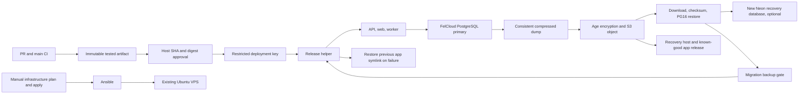

# NASJ infrastructure qualification

## Audit and disposition

- **Verified.** The merged production pipeline passed hosted CI and built its native release. The deployment job was skipped. Main has the required aggregate check. The production Environment restricts deploys to main.
- **Verified.** FelCloud is x86-64 Ubuntu with Node 24.20.0 and PostgreSQL 16. API, web, worker, and Certbot timer were active. Nginx syntax validation passed. The server reported 65 GiB free on the release filesystem. UFW was inactive and provider rules remain unverified.
- **Verified recovery evidence.** An initial Neon snapshot was restored back into an isolated PostgreSQL 16 cluster. Neon runs PostgreSQL 18. A matching PostgreSQL 18 export client was required. Live application database settings have remained on FelCloud.
- **Partial.** Runtime and migration role separation exists. Runtime lacks read access to Prisma migration history. The deployment scripts are merged, but the VPS still has its original real application directory and needs production qualification.
- **External.** S3 endpoint, bucket permissions and lifecycle, encryption custody, alert routing, and protected infrastructure credentials must be supplied. No production apply, cutover, scheduled backup, or migration was performed during implementation.

## Architecture and decisions



Ansible installs configuration and canonical scripts. systemd schedules operations and supervises
the application. The production helper owns artifact authorization, switching and rollback.
Continuous delivery builds releases automatically. Production activation still requires host
authorization of the digest. A future automatic authorization design should verify a trusted
build attestation for the artifact, commit, repository, workflow and main ref using an independent
trust root. Transport credentials must never authorize their own uploads. Application rollback
retains the compatible expanded database schema.

Neon refresh creates a uniquely named database and validates migration checksums and every public
table's row count against the verified restore of the same dump. The pointer changes only after
verification. Existing copies and failed candidates are retained for operator review. Use a
dedicated Neon project and a role with CONNECT and CREATE DATABASE. Never configure the production
app to use the recovery endpoint. A portable PostgreSQL 16 archive is the preferred VPS recovery
source. Neon-native exports require a client at least as new as Neon.

## Configuration matrix

| Setting | Location | Purpose and state |
|---|---|---|
| `DEPLOY_HOST`, `DEPLOY_PORT`, `DEPLOY_USER`, `DEPLOY_SSH_KEY`, `DEPLOY_KNOWN_HOSTS` | GitHub production Environment | Exists by name. VPS restricted access still needs qualification. |
| `PRODUCTION_DEPLOY_ENABLED` | GitHub repository variable | Unset during qualification. |
| `INFRA_WORKFLOW_ENABLED` | GitHub repository variable | Unset pending infrastructure workflow qualification. |
| `INFRA_SSH_KEY`, `INFRA_KNOWN_HOSTS`, `INFRA_EXTRA_VARS` | Protected production-infrastructure Environment | Missing. Use a dedicated infrastructure user/key and trusted known_hosts. |
| `ansible_host`, `ansible_user`, `nasj_public_health_url` | Private Ansible extra vars | Supply actual endpoint, account and address. The tracked inventories contain placeholders. |
| `nasj_deploy_config` | Vault vars | Reviewed deploy config from the template. Existing file is preserved. |
| Runtime and migration env files | `/etc/nasj/runtime.env`, `/etc/nasj/migration.env` | Provision privately from the existing config, with separate owner groups. |
| `BACKUP_DATABASE`, `S3_ENDPOINT`, `S3_BUCKET`, `S3_REGION`, `S3_PREFIX`, `NEON_REFRESH_ENABLED` | Vault map entry `nasj_backup_files['backup.conf']` | Configure S3 and choose whether to refresh Neon. Bucket credentials are separate. |
| AWS shared credentials | Vault map entry `backup.aws` | Missing. Give the backup identity PutObject/GetObject on its prefix and no delete permissions. |
| Age public recipients and restore identity | Vault map entries `backup.recipients`, `backup.identity` | Missing. Keep an independent recovery key copy outside the VPS. The production verifier requires a private identity to check its round trip. |
| `PGHOST`, `PGUSER`, `PGDATABASE=neondb` | Vault map entry `backup-neon.conf` | Existing recovery destination. Direct endpoint and verified TLS required. |
| Dedicated Neon password entry | Vault map entry `backup-neon.pgpass` | Supply securely. Use a database wildcard for newly named candidate databases, restricted to the exact Neon host and role. |
| HTTPS alert target and authentication | Vault map entry `notify.curl` | Missing. Supply a protected curl config with `url` and any auth headers. |

Set private bucket access and versioning. Configure lifecycle expiry for `daily/` (30 days),
`weekly/` (84 days), and `monthly/` (approximately six months). Choose a separate
pre-migration retention policy. Exclude `protected/` from expiry and apply retention lock to
historical versions where supported. Readers should validate a manifest's hash before using any
archive. The historical manifest points to an immutable object even if a protected-pointer
update is interrupted. Configure external backup heartbeat alerts so loss of the host is visible.
The on-host health timer detects expired TLS, service and DB failures, memory and load pressure,
low disk, stale backup receipts, and interrupted deployments.

## Ordered operator qualification

From `infrastructure/ansible`, install `requirements.txt` into an isolated Python environment.
Prepare encrypted extra vars via `ansible-vault create /secure/nasj-production.yml`.
Supply the host address and trusted host SSH entry. Keep an independent administrator session and
provider console access before authorizing SSH changes.

```bash
ansible-playbook -i inventories/production/hosts.yml --ask-vault-pass \
  -e @/secure/nasj-production.yml playbooks/audit.yml
ansible-playbook -i inventories/production/hosts.yml --ask-vault-pass \
  -e @/secure/nasj-production.yml playbooks/configure.yml --check
```

1. Review the S3 permissions, retention, Age key custody and notification route. Verify that
   backup and infrastructure credentials are restricted and separate from application release SSH.
2. After explicit production apply authorization, rerun configure with
   `-e nasj_production_apply=true`. Qualify the restricted key and preserved SSH access
   separately before setting `nasj_reload_ssh=true`. Inventory-specific Nginx, TLS and systemd
   configuration remains in place. Do not paste generic replacement files over existing ones.
3. After approving the read grant, run `playbooks/database-grant.yml` with
   `nasj_confirm_database_grant=true` and the verified database/runtime/migration identifiers.
4. Run `playbooks/backup.yml` with `nasj_run_backup=true`. Require
   `NASJ_BACKUP_READY`, an uploaded manifest and successful verification. Confirm the Neon
   pointer if refresh was enabled. Run the backup twice and validate alarm delivery using a
   separate staging destination before enabling `nasj_enable_backup_timer` and
   `nasj_enable_monitoring`.
5. Review the artifact and approve a maintenance window. Run `playbooks/adopt-release.yml`
   with `nasj_confirm_adoption=true`, then `playbooks/verify.yml`. The adoption script requires
   a fresh verified backup, deployment lock, filesystem and capacity checks. An interrupted
   adoption retains the original and candidate paths in the pending marker.
6. Authorize the reviewed release digest as documented in [the deployment runbook](deployment.md).
   Enable CD only after host qualification, test one compatible release and separately exercise
   rollback. Verify public readiness and worker operations before declaring readiness.

For GitHub infrastructure automation, create the protected Environment and configure review
permissions independently of the application Environment. Run the workflow in plan mode on main,
review its result, then dispatch apply with the successful matching plan run ID. The workflow
runs fresh check mode before apply. Keep the flag unset until the protected Environment and
separate management credentials have been validated. A syntax-valid check run is not an
operational rehearsal.

## Replacement VPS recovery

Use a separate recovery inventory and `playbooks/bootstrap.yml` with
`nasj_confirm_bootstrap=true`. Recreate the approved runtime, migration, and monitoring roles,
and load the off-host copies of the real configuration, pinned Node runtime, trusted SSH host
records, credentials, PostgreSQL extension inventory, and DNS/TLS details. Preserve an off-host
encrypted copy of role grants/settings and archive a known-good application artifact beyond
GitHub Actions artifact expiry. The data backup excludes ownership and ACLs by design.

Retrieve an authenticated manifest and ciphertext. Check SHA-256, decrypt with the recovery
identity in a protected location, then run `playbooks/disaster-recovery.yml` against an isolated
recovery inventory, with `nasj_confirm_restore=true`, `nasj_recovery_database=nasj_recovery_drill`, and the protected dump path. Confirm extensions, runtime grants,
application login/read/write smoke behavior and outbox handling before routing traffic. Start
the known-good app and worker only after verifying backup compatibility. Restore DNS, test public
TLS, and resume backups and alerting. Review potential duplicate background work before starting
the worker.

Initial RPO target is 24 hours, subject to successful nightly runs. Full VPS-loss RTO is
unmeasured. Record stage timings in the first replacement-host rehearsal. If lower RPO is
required, add periodic physical base backups and continuous encrypted WAL archiving with
restore-to-time drills. Neon restore history only covers the copy uploaded to Neon.

## Persistent qualification checklist

- [x] Read-only server audit and historical Neon recovery proof.
- [x] Deployment fault suite and disposable PostgreSQL evidence test.
- [x] Ansible syntax and inventory validation on local tooling.
- [ ] P0: Verify S3 upload/download, protection and retention on the approved bucket.
- [ ] P0: Validate full backup pipeline and Ansible idempotency on disposable Ubuntu 24.04.
- [ ] P0: Qualify dedicated infrastructure and deploy SSH, backup credentials and alerts.
- [ ] P0: Authorize and qualify live backup, restricted access, adoption, first deploy and rollback.
- [ ] P1: Measure full recovery time and archive known-good releases and host config off-site.
- [ ] P2: Automate trusted provenance-based release authorization and evaluate WAL archiving.


## Validation record

| Check | Environment | Expected and observed result | Status |
|---|---|---|---|
| Existing deployment fault suite | Local temporary shell fixtures | Unauthorized artifacts, bad digests, lock contention, signal interruption, backup failures and restart/readiness/worker rollback were handled as expected. | Passed |
| Backup orchestration | Temporary filesystem and fake storage/restore adapters | Valid backup writes receipt. Upload failure, tampered ciphertext, or invalid restore writes no receipt. Failed Neon refresh leaves the verified object-store receipt available. | Passed |
| Backup evidence | Local isolated PostgreSQL 16 Docker container | Matching restore returned identical evidence. Removing a row changed evidence. An unfinished migration failed the check. | Passed |
| Ansible inventory and syntax | Both checked-in sample inventories | Inventory parsing and playbook syntax completed. | Passed |
| ShellCheck, actionlint, YAML and Ansible lint | Local static checking | Scripts and workflows passed the checks run. | Passed |
| Systemd schedule | Local systemd calendar parser | The daily UTC trigger parsed. | Passed |
| Real S3 provider and scheduled backup | Provider and staging host not configured | Requires versioned bucket, authorized credentials and alarm route. | Blocked |
| Production-like Ansible idempotency and service configuration failure paths | Disposable Ubuntu 24.04 with systemd not provisioned | Run two applies, check for no drift, then rehearse invalid Nginx, unit, and SSH configurations. | Pending |
| Live rollback, artifact deployment, full disaster recovery timing | Production changes not authorized | Perform only after staging qualification and a verified remote recovery point. | Pending |

The application workflow still publishes and verifies the same artifact ID and checksum. Treat
a run that became superseded as a deliberate operator decision. Approve only the intended
reviewed digest, and revoke any unused release authorizations. Reuse the original artifact for
a retry. A rebuilt bundle requires fresh authorization even if its source commit matches.
