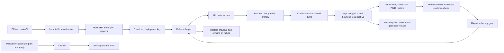

# NASJ infrastructure qualification

## Audit and disposition

- **Verified.** The merged production pipeline passed hosted CI and built its native release. The deployment job was skipped. Main has the required aggregate check. The production Environment restricts deploys to main.
- **Verified.** FelCloud is x86-64 Ubuntu with Node 24.20.0 and PostgreSQL 16. API, web, worker, and Certbot timer were active. Nginx syntax validation passed. The server reported 65 GiB free on the release filesystem. UFW was inactive and provider rules remain unverified.
- **Verified recovery evidence.** An initial Neon snapshot was restored back into an isolated PostgreSQL 16 cluster. Neon runs PostgreSQL 18. A matching PostgreSQL 18 export client was required. Live application database settings have remained on FelCloud.
- **Partial.** Runtime and migration role separation exists. Runtime lacks read access to Prisma migration history. The deployment scripts are merged, but the VPS still has its original real application directory and needs production qualification.
- **External.** A dedicated local backup volume, Age key custody, alert routing, and protected infrastructure credentials still need production configuration. No production apply, cutover, scheduled backup, or migration was performed during implementation.

## Architecture and decisions



Ansible installs configuration and canonical scripts. systemd schedules operations and supervises
the application. The production helper owns artifact authorization, switching and rollback.
Continuous delivery builds releases automatically. Production activation still requires host
authorization of the digest. A future automatic authorization design should verify a trusted
build attestation for the artifact, commit, repository, workflow and main ref using an independent
trust root. Transport credentials must never authorize their own uploads. Application rollback
retains the compatible expanded database schema.

Neon refresh creates a uniquely named database and validates migration checksums and every public
table's row count against the verified restore of the same dump. The pointer changes only after
verification. Existing copies and failed candidates are retained for operator review. Use a
dedicated Neon project and a role with CONNECT and CREATE DATABASE. Never configure the production
app to use the recovery endpoint. A portable PostgreSQL 16 archive is the preferred VPS recovery
source. Neon-native exports require a client at least as new as Neon.

## Configuration matrix

| Setting | Location | Purpose and state |
|---|---|---|
| `DEPLOY_HOST`, `DEPLOY_PORT`, `DEPLOY_USER`, `DEPLOY_SSH_KEY`, `DEPLOY_KNOWN_HOSTS` | GitHub production Environment | Exists by name. VPS restricted access still needs qualification. |
| `PRODUCTION_DEPLOY_ENABLED` | GitHub repository variable | Unset during qualification. |
| `INFRA_WORKFLOW_ENABLED` | GitHub repository variable | Unset pending infrastructure workflow qualification. |
| `INFRA_SSH_KEY`, `INFRA_KNOWN_HOSTS`, `INFRA_EXTRA_VARS` | Protected production-infrastructure Environment | Missing. Use a dedicated infrastructure user/key and trusted known_hosts. |
| `ansible_host`, `ansible_user`, `nasj_public_health_url` | Private Ansible extra vars | Supply actual endpoint, account and address. The tracked inventories contain placeholders. |
| `nasj_deploy_config` | Vault vars | Reviewed deploy config from the template. Existing file is preserved. |
| Runtime and migration env files | `/etc/nasj/runtime.env`, `/etc/nasj/migration.env` | Provision privately from the existing config, with separate owner groups. |
| `BACKUP_DATABASE`, `BACKUP_MAX_MIB`, `NEON_REFRESH_ENABLED` | Vault map entry `nasj_backup_files['backup.conf']` | Set the existing database name, archive limit (default 256 MiB), and enable nightly Neon refresh in production. A migration always requires Neon. |
| `nasj_backup_volume_uuid` | Private Ansible extra vars | UUID of a preformatted, capacity-bounded ext4 filesystem. Required for the opt-in mount playbook. No formatting is performed. |
| Age public recipients and restore identity | Vault map entries `backup.recipients`, `backup.identity` | Missing. Keep an independent recovery key copy outside the VPS. The production verifier requires a private identity to check its round trip. |
| `PGHOST`, `PGUSER`, `PGDATABASE=neondb` | Vault map entry `backup-neon.conf` | Existing recovery destination. Direct endpoint and verified TLS required. |
| Dedicated Neon password entry | Vault map entry `backup-neon.pgpass` | Supply securely. Use a database wildcard for newly named candidate databases, restricted to the exact Neon host and role. |
| HTTPS alert target and authentication | Vault map entry `notify.curl` | Missing. Supply a protected curl config with `url` and any auth headers. |

The selected storage is a private encrypted local filesystem at `/srv/nasj-backups`.
A loopback S3 service could reuse the old client abstraction but would add a server,
authentication and lifecycle configuration, a network listener, and resource overhead.
It would share the VPS failure domain either way. The filesystem creates no storage endpoint,
API or administrative interface, and removes the need for AWS credentials. Root owns archive
directories and files. The disposable restore account can write only its private workspace.
Do not configure the proposed port 9000 or buckets.

Use a dedicated, capacity-bounded filesystem with `nodev,nosuid,noexec,nofail`. Prefer a
separate block volume; an existing, fully preallocated image is an alternative only if its
capacity can be reserved without compromising the database filesystem. Never use an
unbounded sparse production file on the database disk. The backup refuses the PostgreSQL
filesystem and refuses to proceed if the mount is absent. The dump streams directly into Age encryption. Encrypted scratch files and temporary restore
clusters use the same bounded mount. The operation requires free space equal to at least six
times the configured per-file limit plus 512 MiB. Start by reserving 8 GiB for the current
small workload, measure growth and increase only after checking host capacity.

Retention treats daily, weekly, monthly and pre-migration archives independently with 30,
84, 183 and 30 days respectively. It considers only complete backup pairs and leaves the
newest verified pair per class. Review incomplete artifacts and obsolete Neon candidates
separately. The Neon refresh never drops a previous recovery database.

**Full VPS loss also loses the local archive history.** Neon is the only off-host database
recovery destination in this design. Its latest verified database is the recovery point.
If both FelCloud and Neon are inaccessible, this setup cannot recover the database. A same-host
receipt never qualifies a migration. The hook creates a new Neon database from the exact
current snapshot, compares restored table and migration evidence, and publishes a release-bound
off-host receipt only on success. Keep the current Neon project and recovery access recorded
outside the VPS. The production PostgreSQL data and Nginx/systemd service lifecycle are
independent of backup mount or Neon failure.

Configure an external heartbeat to detect loss of the host. The local monitor checks TLS,
applications, database, CPU load, memory, disk, local and off-host backup freshness, and
unfinished deployment state. Alerts need an operator-approved destination.

## Ordered operator qualification

From `infrastructure/ansible`, install `requirements.txt` into an isolated Python environment.
Prepare encrypted extra vars via `ansible-vault create /secure/nasj-production.yml`.
Supply the host address and trusted host SSH entry. Keep an independent administrator session and
provider console access before authorizing SSH changes.

```bash
ansible-playbook -i inventories/production/hosts.yml --ask-vault-pass \
  -e @/secure/nasj-production.yml playbooks/audit.yml
ansible-playbook -i inventories/production/hosts.yml --ask-vault-pass \
  -e @/secure/nasj-production.yml playbooks/configure.yml --check
```

1. Reserve and format a dedicated ext4 volume outside the PostgreSQL filesystem. Record its
   UUID. After separate mount approval, run `playbooks/mount-backup.yml` with
   `nasj_confirm_backup_mount=true` and the reviewed UUID. Verify `findmnt /srv/nasj-backups`.
   Review retention, Age key custody, Neon access and the notification route.
2. After explicit production apply authorization, rerun configure with
   `-e nasj_production_apply=true`. Qualify the restricted key and preserved SSH access
   separately before setting `nasj_reload_ssh=true`. Inventory-specific Nginx, TLS and systemd
   configuration remains in place. Do not paste generic replacement files over existing ones.
3. After approving the read grant, run `playbooks/database-grant.yml` with
   `nasj_confirm_database_grant=true` and the verified database/runtime/migration identifiers.
4. Run `playbooks/backup.yml` with `nasj_run_backup=true`. Require
   `NASJ_BACKUP_READY`, a matching local manifest and successful isolated restore. Require a fresh Neon
   receipt and test recovery from that database before enabling deployment. Run the backup twice and validate alarm delivery using a
   separate staging destination before enabling `nasj_enable_backup_timer` and
   `nasj_enable_monitoring`.
5. Review the artifact and approve a maintenance window. Run `playbooks/adopt-release.yml`
   with `nasj_confirm_adoption=true`, then `playbooks/verify.yml`. The adoption script requires
   a fresh verified backup, deployment lock, filesystem and capacity checks. An interrupted
   adoption retains the original and candidate paths in the pending marker.
6. Authorize the reviewed release digest as documented in [the deployment runbook](deployment.md).
   Enable CD only after host qualification, test one compatible release and separately exercise
   rollback. Verify public readiness and worker operations before declaring readiness.

For GitHub infrastructure automation, create the protected Environment and configure review
permissions independently of the application Environment. Run the workflow in plan mode on main,
review its result, then dispatch apply with the successful matching plan run ID. The workflow
runs fresh check mode before apply. Keep the flag unset until the protected Environment and
separate management credentials have been validated. A syntax-valid check run is not an
operational rehearsal.

## Replacement VPS recovery

Use a separate recovery inventory and `playbooks/bootstrap.yml` with
`nasj_confirm_bootstrap=true`. Recreate the approved runtime, migration, and monitoring roles,
and load the off-host copies of the real configuration, pinned Node runtime, trusted SSH host
records, credentials, PostgreSQL extension inventory, and DNS/TLS details. Preserve an off-host
encrypted copy of role grants/settings and archive a known-good application artifact beyond
GitHub Actions artifact expiry. The data backup excludes ownership and ACLs by design.

For complete VPS loss, use the latest verified Neon database. Export with a client matching
Neon and test on disposable PostgreSQL 16 before starting recovery. Create a PostgreSQL 16 custom-format dump from that validated restore for the recovery playbook. If the local archive
volume survived, check the Age archive SHA-256 and decrypt in a protected location. Then run `playbooks/disaster-recovery.yml` against an isolated
recovery inventory, with `nasj_confirm_restore=true`, `nasj_recovery_database=nasj_recovery_drill`, and the protected dump path. Confirm extensions, runtime grants,
application login/read/write smoke behavior and outbox handling before routing traffic. Start
the known-good app and worker only after verifying backup compatibility. Restore DNS, test public
TLS, and resume backups and alerting. Review potential duplicate background work before starting
the worker.

Initial RPO target is 24 hours, subject to successful nightly runs. Full VPS-loss RTO is
unmeasured. Record stage timings in the first replacement-host rehearsal. If lower RPO is
required, add periodic physical base backups and continuous encrypted WAL archiving with
restore-to-time drills. Neon restore history only covers the copy uploaded to Neon.

## Persistent qualification checklist

- [x] Read-only server audit and historical Neon recovery proof.
- [x] Deployment fault suite and disposable PostgreSQL evidence test.
- [x] Ansible syntax and inventory validation on local tooling.
- [x] P0 implementation: same-host archive, retention and independent migration gate.
- [x] P0: Qualify the bounded archive filesystem and mount idempotency in the Ubuntu VM.
- [ ] P0: Exercise a real remote refresh against a separate synthetic Neon database or project.
- [x] P0: Validate full local archive pipeline and Ansible idempotency on disposable Ubuntu 24.04.
- [x] P0: Exercise synthetic adoption, restricted SSH deploy, rollback, alert, and recovery in the VM.
- [ ] P0: Qualify dedicated infrastructure and deploy SSH, backup credentials and alerts.
- [ ] P0: Authorize and qualify live backup, restricted access, adoption, first deploy and rollback.
- [ ] P1: Measure full recovery time and archive known-good releases and host config off-site.
- [ ] P2: Automate trusted provenance-based release authorization and evaluate WAL archiving.


## Validation record

| Check | Environment | Expected and observed result | Status |
|---|---|---|---|
| Existing deployment fault suite | Local temporary shell fixtures | Unauthorized artifacts, bad digests, lock contention, signal interruption, backup failures and restart/readiness/worker rollback were handled as expected. | Passed |
| Backup orchestration | Temporary filesystem and fake storage/restore adapters | Nightly and migration success, missing mount, failed write, invalid restore, failed Neon refresh and wrong Neon receipt passed. A same-host receipt alone cannot authorize migration. | Passed |
| Backup evidence | Local isolated PostgreSQL 16 Docker container | Matching restore returned identical evidence. Removing a row changed evidence. An unfinished migration failed the check. | Passed |
| Ansible inventory and syntax | Both checked-in sample inventories | Inventory parsing and playbook syntax completed. | Passed |
| ShellCheck, actionlint, YAML and Ansible lint | Local static checking | Scripts and workflows passed the checks run. | Passed |
| Systemd schedule | Local systemd calendar parser | The daily UTC trigger parsed. | Passed |
| VM boot and dedicated storage isolation | Ubuntu 24.04.5 minimal cloud guest on KVM | Verified image digest, successful cloud-init, pinned host key, separate ext4 archive device and restrictive mount options. | Passed |
| S3 upload and download | Not selected | Local filesystem opens no listener and requires no S3 account. | Not applicable |
| Dedicated volume provisioning and repeat apply | Disposable Ubuntu 24.04.5 guest | The storage role changed 2 tasks then 0 on the second run. UUID-based mount persistence changed 1 task then 0 on the second run. Neither run failed. | Passed |
| Full Ansible configuration idempotency | Disposable Ubuntu 24.04.5 guest | Second configure returned 28 OK, zero changed, and zero failed. | Passed |
| Local encrypted archive, retention and timer | Ubuntu guest, real Age, PostgreSQL 16 and systemd | The service wrote a valid encrypted backup receipt after a real isolated restore, retention kept its pinned pair and removed an expired pair, and the nightly timer scheduled successfully. | Passed |
| Restricted SSH and authorized release lifecycle | Ubuntu guest, synthetic release and real systemd/Nginx/TLS | Arbitrary command rejected, adoption succeeded and repeated cleanly, authorized candidate deployed, and worker failure restored the prior healthy release. | Passed |
| Recovery guard and invalid configurations | Ubuntu guest | A pending marker blocked the next release and was reconciled. Invalid Nginx, systemd and SSH files were rejected without affecting running services. Missing backup mount blocked backup while PostgreSQL still returned the fixture row. | Passed |
| Alert and database recovery | Ubuntu guest, test HTTPS receiver and synthetic database | Alert POST reached the receiver and returned 204. The archive restored into an isolated database and returned the expected fixture row. | Passed |
| Pre-migration off-host failure gate | Ubuntu guest and disposable mock tests | A real local archive with no Neon config failed the migration command and wrote no off-host receipt. Wrong remote receipts and failed refreshes also failed in the mock suite. | Passed |
| Fresh Neon recovery point from the new hook | No synthetic Neon destination connected to the VM | The earlier production Neon copy and independent restore remain valid historical evidence. The new candidate automation has not written to production Neon during this qualification. | Pending |
| Live rollback, artifact deployment, full disaster recovery timing | Production changes not authorized | Perform only after staging qualification and a verified remote recovery point. | Pending |

The application workflow still publishes and verifies the same artifact ID and checksum. Treat
a run that became superseded as a deliberate operator decision. Approve only the intended
reviewed digest, and revoke any unused release authorizations. Reuse the original artifact for
a retry. A rebuilt bundle requires fresh authorization even if its source commit matches.


## Local VM qualification

The development workstation has KVM, 12 logical CPUs, 15 GiB RAM and over 300 GiB
available on its workspace filesystem. Qualification booted a QEMU/KVM Ubuntu 24.04.5
guest with 2 vCPUs,
3 GiB RAM, a 24 GiB sparse OS image and a separate 8 GiB sparse test backup image.
The sparse devices are appropriate for the disposable workstation guest only.
SSH forwards on workstation loopback to guest port 22. The seed injects a unique
host key and the launcher writes a matching known_hosts file. The guest verified a
separate 7.8 GiB-formatted ext4 archive device with all three restricted mount flags.

Download the official Ubuntu 24.04 minimal amd64 cloud image and its SHA256SUMS
over HTTPS and verify the image before launching. Use a private work directory
outside the Git tree:

```bash
python3 -m venv /path/to/private-vm-tools
/path/to/private-vm-tools/bin/pip install -r infrastructure/staging/requirements.txt
/path/to/private-vm-tools/bin/python infrastructure/staging/prepare-vm.py \
  /path/to/verified-ubuntu.qcow2 /path/to/new-private-nasj-vm
```

Wait for `cloud-init status --wait` using the generated admin and pinned host key.
Run `bash infrastructure/staging/qualify-vm.sh /path/to/new-private-nasj-vm` from the
repository root. The harness provisions Ubuntu, configures twice, checks restricted SSH,
and exercises TLS health, Age archive recovery, retention, alerts, adoption, a synthetic
artifact switch and rollback, the recovery marker, and missing-mount handling. It uses a synthetic receipt only
after proving that a local archive does not pass the migration gate. A synthetic Neon branch/project and credential are required
for real remote integration. Never use the production recovery copy for fault injection.
