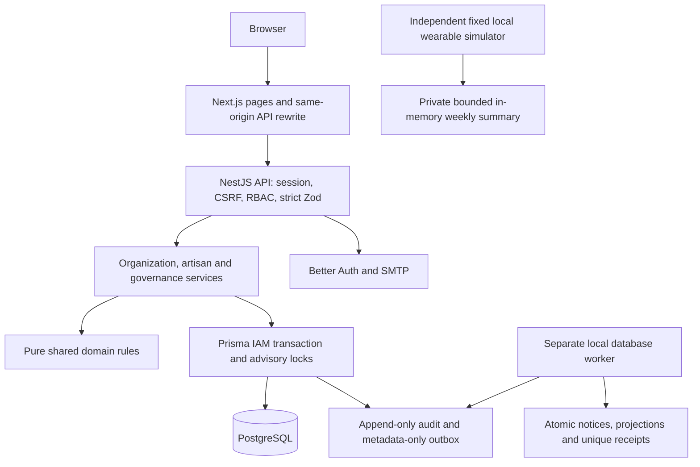

# Implemented architecture

One website repository contains three application/shared packages; contracts include pure `domain.ts`. No new broker or service infrastructure is required. Browser code never reads PostgreSQL. No AI/IoT runtime integration exists. Organization membership/approval and artisan ownership or consent-bound delegation define scopes; global administrators do not inherit artisan/organization access.

The domain module preserves actual organization rules: draft/rejected profiles may be edited/submitted; pending/suspended organizations may be approved/rejected; only approved organizations may be suspended. Suspended-to-rejected is existing behavior. The synthetic RFQ/order/offer/batch/QA/payment implementation and its pure guarded machines are described in [commerce architecture](commerce.md).

Capacity remains voluntary and independent of sensors. Periods are half-open; adjacent periods do not overlap. A revision must exactly match an overlapping current period, and supersedes its metadata without deleting history. Quantities use exact decimal strings for PostgreSQL Decimal(12,2), 0..100000 with at most two fractional digits.

TND helpers accept canonical nonnegative decimal strings with at most three fractional digits. Internal values are bigint millimes (1000 per TND), capped at signed 64-bit maximum 9223372036854775807 millimes. API/UI serialization is a three-decimal string, never bigint JSON or binary float. Inputs with excess precision, signs, whitespace, exponent or leading zeros are rejected. Rational proration rounds HALF_UP once at the final millime; addition checks overflow. These utilities are used by synthetic quote, offer and settlement commands. They do not implement live money movement.

Capacity keys bind actor, resolved profile, operation and SHA-256 key hash; canonical parsed-payload hashes detect conflicts. Outcomes, mutation, audit and event commit together. IAM locks serialize current callers and a unique index backs the ledger. Resource access, active session, consent and active skill are rechecked even for replay. Outcomes retain the original response indefinitely by default; do not purge until a reviewed deduplication/retention window exists. Never use this helper outside the documented transaction and lock order.

All existing calls to the IAM `audit()` helper now insert version-1 outbox records in the same transaction. Historical audits and other legacy logging paths are not backfilled. Events allow only IDs, action/type, tenant scope, timestamps and correlation metadata. No free text, snapshots, capacity values, monitoring or health fields are copied. Actor/profile IDs remain personal identifiers, so the queue and receipts stay private and require retention review. The consumer never aggregates event payloads: it resolves commerce IDs to authoritative SYNTHETIC records, validates tenant/provenance and builds a versioned SIMULATED projection. Non-commerce events only receive internal receipts. Monitoring data has no input path.

The worker delivers commerce event codes to scoped in-app notices, rebuilds per-order metrics and writes a unique receipt in one transaction. PENDING/RETRY rows are claimed with `FOR UPDATE SKIP LOCKED`; the database lock is the running state. A killed transaction releases its claim. A savepoint rolls back failed local consumer effects; delivery status, attempts, duration and a fixed error code are recorded. Five failed attempts enter FAILED, with exponential delays (2^attempt seconds, capped at one hour). CLI replay resets the attempt budget for a selected failed event. Receipts deduplicate at-least-once delivery. External notification delivery and distributed leases are not implemented; the row lock provides crash recovery for local transactions. The same existing outbox provides bounded retryable ETL without another queue. Shared IAM locks deliberately serialize current prototype commands/consumers; throughput must be measured before any scaling claim. Existing invitation/support email remains outside this worker and is not claimed replay-safe.

## Rebuildable reports and local simulation

`CommerceProjection` is a disposable per-order read model; `CommerceNotice` stores only fixed event codes and audience scopes. `jobs/commerce-consumer.ts` rebuilds metrics from orders/batches/offers/payments plus immutable shipment/acceptance audit milestones. Source ledger tables are never updated by ETL. The version-1 shared registry in contracts defines exact millime strings and distinct produced/submitted/approved/shipped/received/accepted numerators with requested quantity denominators. Reporting window is order lifetime through `asOf`, timezone UTC. Unknown actual costs/hours/verified settlement remain null with UNAVAILABLE coverage. No real payment is represented as verified.

Current approved organization memberships are rechecked transactionally on reports/CSV/inbox. Buyer reports omit artisan earnings/payments; finance can see the scoped synthetic aggregate; QA/logistics receive fulfillment only; artisans cannot query a whole-order report. Notices expose fixed labels/times, not arbitrary audit snapshots or target IDs. CSV cells are fixed metric names, enum units and integers; no user-entered spreadsheet formulas. `worker --rebuild-analytics` supports bounded safe backfill without duplicate notices. See [operations](../operations/README.md).

The independent IoT repository’s `simulator` project has no commerce/database/network dependency and is invoked only explicitly through its local CLI/tests. It cannot feed analytics or mutate voluntary capacity. Device adapters, configuration assumptions and simulator/physical evidence boundaries are documented in [firmware](../firmware/README.md).
